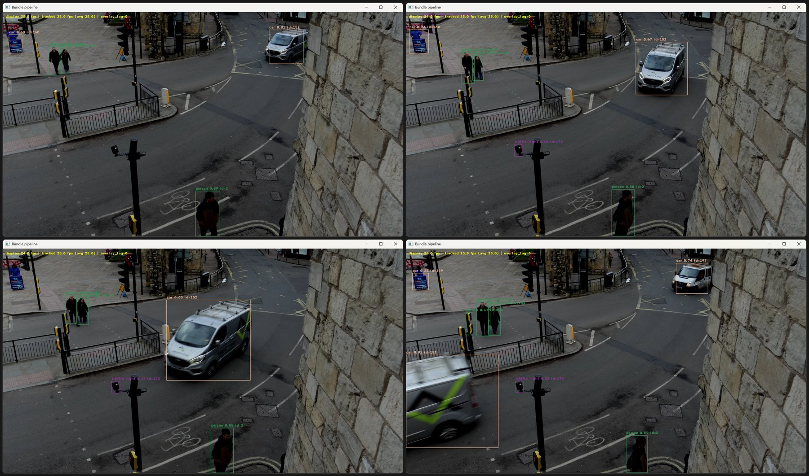
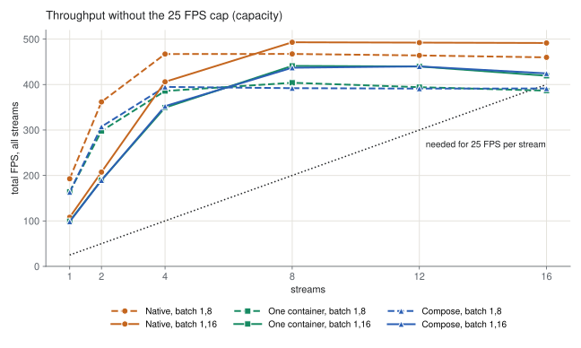
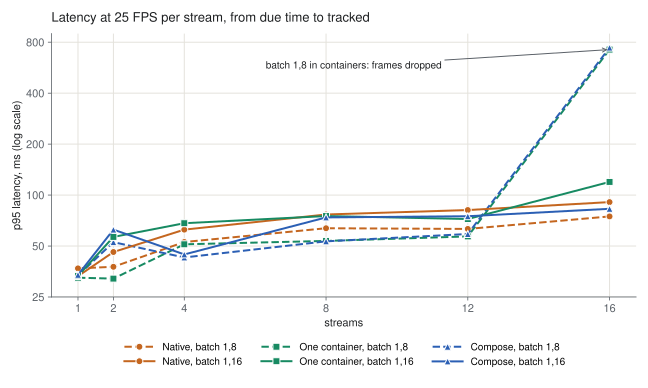
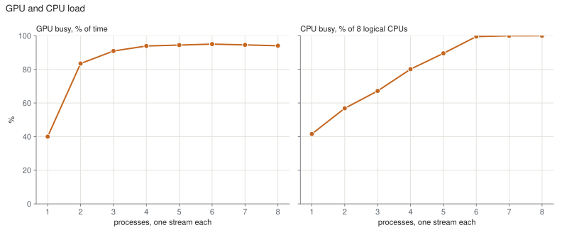
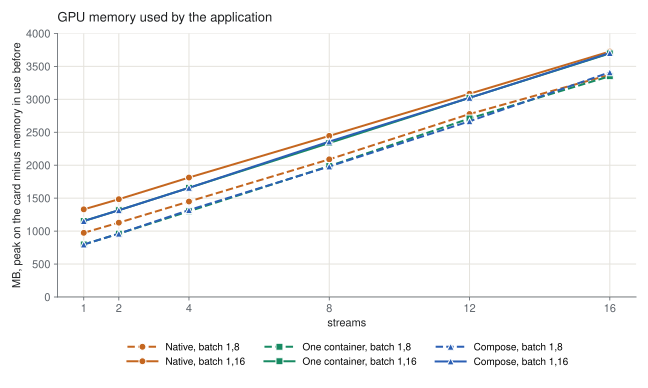
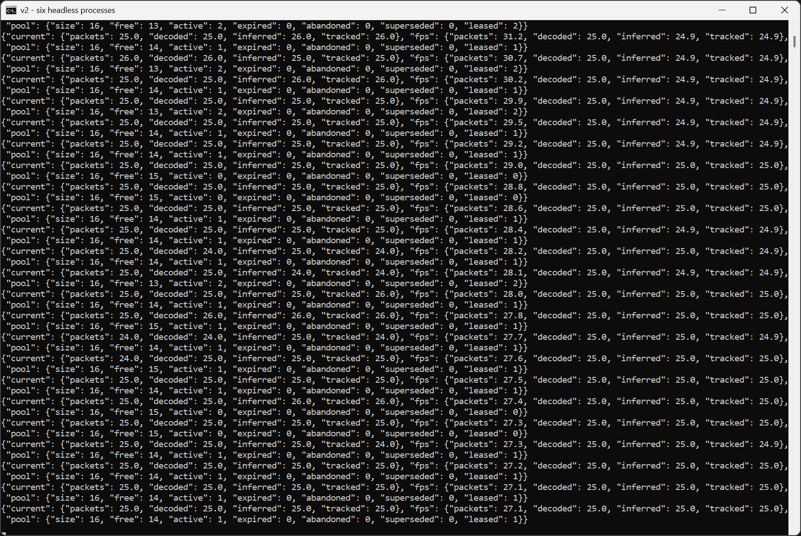
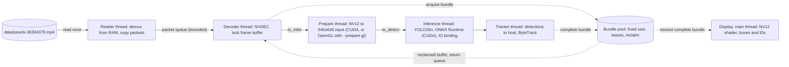

# multistream-gpu-inference, v2: bundle pipeline

This branch keeps v2, an earlier version of this project. The current version is on the
[main branch](https://github.com/BarabashkaD/multistream-gpu-inference); the previous one is
[v1-single-stream](https://github.com/BarabashkaD/multistream-gpu-inference/tree/v1-single-stream).

v2 runs real-time object detection and tracking on one video stream per process, on an NVIDIA GPU. Inside the process
the work is a pipeline of threads: read, decode on the GPU (NVDEC), prepare, detect with YOLO26n in ONNX Runtime with
CUDA, track with ByteTrack, and show the stream in an OpenGL window. Frames move between the threads as bundles from a
fixed pool, so memory stays bounded and a decoded frame reaches the detector without a copy. Several streams are
several processes, each with its own model.

On one GeForce RTX 2070 SUPER (8 GB), 5 processes hold 25 FPS each, 127 frames a second in total, and 4 hold it with a
window each.



## Performance

Measured on 2026-11-06 on the machine under [Requirements](#requirements): one stream per process, headless, one test
clip (1920x1080, 25 FPS), 2 loops per process, one run per point, at 25 FPS per stream and without the cap
(`--pace max`).









| Load | Total FPS | Slowest process, FPS | Latency estimate, ms | GPU busy, % | CPU, % | GPU memory, MB |
| --- | --- | --- | --- | --- | --- | --- |
| 1 process, 25 FPS | 25.6 | 25.6 | 17.9 | 23 | 16 | 484 |
| 5 processes, 25 FPS each: the most that hold | 127.2 | 25.4 | 29.9 | 75 | 59 | 2691 |
| 6 processes, 25 FPS each: falls behind | 150.0 | 24.9 | 356 | 93 | 99 | 2900 |
| 1 process without the cap | 129.4 | 129.4 | | 37 | 43 | 511 |
| 2 processes without the cap: the highest total | 158.5 | 78.8 | | 78 | 50 | 997 |

- **The limit.** From 2 processes the total stays at about 150 to 158 FPS, whatever the number of processes. Each
  process runs its own model one frame at a time, the GPU is 78 to 93% busy, and from 5 or 6 processes the CPU is
  close to 100%.
- **6 processes** fall just below 25 FPS: frames fall behind the source by 0.3 to 0.85 s. 7 and 8 get 21.4 and 18.6
  FPS per stream.
- **Without the cap, 8 processes** were stopped after 39 s, when free GPU memory fell below 400 MB.
- **Latency** is an estimate: the sum of the median stage times from a frame's due time to the end of its tracking.
  v2 does not record the time a frame waits in the queues after preparation, so the true latency is higher.
- **GPU busy** is the share of time the card ran any kernel. **CPU** counts all 8 logical CPUs.
- **GPU memory** is the card's peak minus the memory other programs held before the run (3.55 to 3.84 GB). Each process
  adds about 0.5 GB: its own model, session and buffers.
- **With windows**, 4 processes hold 25 FPS each, and each window shows all but 31 to 45 of the 1222 frames (a run
  earlier the same day; 6 or more windows were not tested).

<details>
<summary>All points of the charts</summary>

| At 25 FPS per stream | 1 | 2 | 3 | 4 | 5 | 6 | 7 | 8 |
| --- | --- | --- | --- | --- | --- | --- | --- | --- |
| Total FPS | 25.6 | 50.7 | 76.1 | 101.8 | 127.2 | 150.0 | 150.3 | 153.1 |
| Slowest process, FPS | 25.6 | 25.3 | 25.4 | 25.4 | 25.4 | 24.9 | 21.4 | 18.6 |
| Latency estimate, ms | 17.9 | 24.2 | 28.4 | 28.7 | 29.9 | 356 | 5202 | 10685 |
| GPU busy, % | 23 | 34 | 47 | 58 | 75 | 93 | 91 | 92 |
| NVDEC, % | 4 | 3 | 5 | 6 | 7 | 9 | 8 | 8 |
| CPU, % | 16 | 26 | 31 | 62 | 59 | 99 | 99 | 99 |
| GPU memory, MB | 484 | 982 | 1473 | 2388 | 2691 | 2900 | 3270 | 3935 |
| Median inference, ms | 7.3 | 13.5 | 17.6 | 18.0 | 18.7 | 39.6 | 45.5 | 52.9 |

| Without the cap (`--pace max`) | 1 | 2 | 3 | 4 | 5 | 6 | 7 | 8 |
| --- | --- | --- | --- | --- | --- | --- | --- | --- |
| Total FPS | 129.4 | 158.5 | 155.4 | 152.4 | 147.1 | 150.0 | 151.8 | stopped |
| Slowest process, FPS | 129.4 | 78.8 | 51.5 | 38.0 | 29.2 | 24.9 | 21.3 | stopped |
| GPU busy, % | 37 | 78 | 87 | 88 | 91 | 92 | 91 | stopped |
| NVDEC, % | 5 | 8 | 8 | 8 | 8 | 8 | 8 | stopped |
| CPU, % | 43 | 50 | 68 | 82 | 97 | 98 | 99 | stopped |
| GPU memory, MB | 511 | 997 | 1496 | 1995 | 2925 | 3217 | 3467 | stopped |
| Median inference, ms | 7.2 | 12.3 | 19.1 | 25.7 | 32.8 | 39.1 | 45.6 | stopped |

The run with one process without the cap lasted about 10 s, so its GPU and CPU means include start-up. A 3-loop run of
one process reaches 146.5 FPS.

</details>

Every table, the single-process runs, the runs with windows and the method are in
[docs/performance-and-design.md](docs/performance-and-design.md).

## Requirements

- An NVIDIA GPU with a current driver. Measured on a GeForce RTX 2070 SUPER (8 GB, driver 616.56), an Intel Core
  i7-9700K, 32 GB RAM, Windows 11.
- Windows with Python 3.14 (measured). The Linux steps are untested.
- PyNvVideoCodec 2.2.3, the only tested version; `requirements-pipeline.txt` pins it with the other packages.

## Build and run

From the repository root, in PowerShell:

```powershell
py -3.14 -m venv .venv
.venv\Scripts\python.exe -m pip install -r requirements-pipeline.txt
.venv\Scripts\python.exe download_clip.py      # the test clip, data\pexels-36304379.mp4
.venv\Scripts\python.exe prepare_model.py      # the model, yolo26n.onnx

.venv\Scripts\python.exe run_pipeline.py --loops 2                              # one stream in a window
.venv\Scripts\python.exe run_pipeline.py --no-display --pace max --loops 3      # headless, as fast as it goes
```

For several streams, start several processes. Each prints one JSON status line a second, with the current and average
rate of every stage and the state of its bundle pool:



Press Q or Esc, or close the window, to stop. The Linux commands and every option are in
[Running in detail](docs/performance-and-design.md#running-in-detail).

## Architecture



- **Bundles.** A fixed pool (16 by default) carries each frame through the stages. The decoder blocks when no bundle
  is free, which bounds memory and holds back the reader. A bundle is reclaimed once it is shown, superseded, abandoned
  or too old, and never while a stage leases it.
- **No copy before inference.** The decoded NV12 frame stays in the decoder's locked buffer; preparation reads it there
  on the GPU. Two copies remain: into an OpenGL buffer for the window, and the detections to the host for tracking.
- **One process, one stream, one model.** Inference runs one frame at a time. More streams mean more processes, and
  each loads its own model: that is the limit the next version, with one batching server for all streams, removes.

The stages in detail are in [docs/performance-and-design.md](docs/performance-and-design.md#what-this-version-does),
and the design with the measurements behind each decision in
[docs/design/bundle-pipeline.md](docs/design/bundle-pipeline.md).

## Versions

| Version | Branch | Design |
| --- | --- | --- |
| v1 | [v1-single-stream](https://github.com/BarabashkaD/multistream-gpu-inference/tree/v1-single-stream) | One process per stream, each with its own model |
| v2 | `v2-bundle-pipeline` (this branch) | One stream per process as a threaded pipeline of bundles |
| v3 | [main](https://github.com/BarabashkaD/multistream-gpu-inference/tree/main) | One batching inference server for all streams |

## License

Licensed under the GNU Affero General Public License, version 3 or (at your option) any later version
([LICENSE](LICENSE)), with the additional terms in [NOTICE](NOTICE): author attribution, marking of modified
versions, and permission to combine the program with NVIDIA libraries. Ultralytics and YOLO26 are licensed under
AGPL-3.0. The licenses of the dependencies are in [THIRD_PARTY_NOTICES.md](THIRD_PARTY_NOTICES.md).

The test clip is Pexels video 36304379, "Busy urban intersection from above", subject to the Pexels license (see
[NOTICE](NOTICE)). It is not part of the repository.

Copyright (C) 2026 Dmitry Veremeev

To cite this software, use [CITATION.cff](CITATION.cff).

### Temporal batching (v2)

`run_pipeline.py --batch-size N` groups consecutive prepared frames from **one**
video stream into a single inference call. The default is 1 (the original direct
per-frame path). Each process still owns its model; this is not v3's shared server.

Export and run a square batch-4 model:

```sh
python prepare_model.py --batch-size 4
python run_pipeline.py --model yolo26n-b4.onnx --batch-size 4 --pace max --no-display
```

The model must have static FP32 input `[N,3,640,640]` and output `[N,300,6]`.
Batch-1 keeps `yolo26n.onnx`; other batches use `yolo26n-bN.onnx`. Export is
isolated and validated before replacing its destination. GPU staging/scatter
copies are used for N>1; this is not a zero-copy batching operation.

The default pool is `max(16, N+2)`; an explicit `--pool-size` must be at least
`max(4, N+2)`. Programmatic PipelineConfig callers must set a sufficient pool.
A partial batch at EOF or a loop boundary duplicates its last real frame. Only
real results go to the single ordered tracker. Padding never advances tracking
or counts as a processed frame. Loops are never mixed in one batch.

EOF drains normally. Q/Esc/Ctrl-C and stage errors keep v2's **abort** semantics:
pending batches/queues are cancelled, counted separately, and leases are released
before the decoder exits. They are not promised a final inference. A GPU failure
whose completion cannot be established retains its owners rather than reusing
possibly active memory. A stuck-stage error requires terminating the process.

At 25 FPS real-time pacing, the first frame of batch 4 may wait 120 ms just to
fill the batch (batch 8: 280 ms). No artificial sleep is added. Display still uses
the latest available frame and can show old tracks after its grace period; larger
batches can increase mismatched/omitted displays. No MP4 recording is added.

Final JSON reports `batch_size`, pool size, `inference_calls`, full/partial batches,
padding slots, batch-size counters, cancellations, and median/p95 timings for
batch fill, inference call, per-real-frame inference cost, and published/due-to-tracked.
Timings retain the latest 1024 samples; they are not full-run quantiles. `infer`
now measures an entire call (including staging/scatter), not a single frame.
Max-speed file latency is not live-source accumulation latency.

CPU contracts: `python -m pytest tests/test_temporal_batch.py tests/test_config.py tests/test_bundle_pool.py tests/test_stage_metrics.py`. These cover duplicate
padding, tails, loop isolation, cancellation, export failure preservation and
shutdown handshakes using fake inference. Real ONNX export/inference, GPU memory,
GL/display and performance/quality comparisons still require hardware validation.

### Select detector input shape

`run_pipeline.py --imgsz 640` (the default) keeps the original 640×640 input.
`--imgsz 384 640` selects 640×384; two values are **height width**, not width height.
Sizes must be positive multiples of 32. Source aspect ratio is preserved with letterbox padding;
GUI/source coordinates are unchanged. This is a startup option, not runtime reshaping.

```powershell
python prepare_model.py --imgsz 384 640 --batch-size 4
python run_pipeline.py --model yolo26n-640x384-b4.onnx --imgsz 384 640 --batch-size 4 --no-display --pace max
```

Each static model is specific to its shape and batch. Square names remain `yolo26n.onnx`
and `yolo26n-b4.onnx`; rectangular names include width×height. Export validates the isolated
temporary file before replacing that exact variant. Runtime rejects mismatched graph dimensions
and contradictory batch/size metadata. Legacy missing metadata is accepted because v2 binds
directly to the validated ONNX graph, not an Ultralytics predictor.

Both CUDA and opt-in OpenGL preparation use the selected canvas. For 1080p video the picture
remains 640×360: padding changes from 140 to 12 rows per side. Other aspect ratios may reduce
useful image resolution. Fewer input pixels do not guarantee unchanged accuracy or faster pipeline
throughput. Compare identical weights/batches separately from batch-size changes.

Validation for this change: CPU/mocked shape, export, geometry and batching contracts. Real
ONNX export, CUDA/GL parity, tracking accuracy, memory and performance measurements remain pending.
