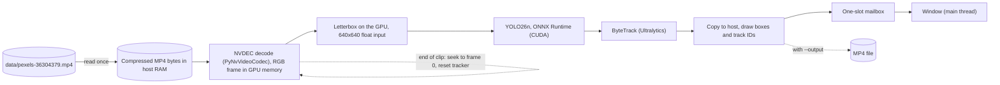

# multistream-gpu-inference, v1: single stream

This branch keeps v1, the first version of this project. The current version is on the
[main branch](https://github.com/BarabashkaD/multistream-gpu-inference); the next one is
[v2-bundle-pipeline](https://github.com/BarabashkaD/multistream-gpu-inference/tree/v2-bundle-pipeline).

v1 runs object detection and tracking on one video stream per process, on an NVIDIA GPU. It reads the compressed MP4
once into RAM, decodes it on the GPU (NVDEC), letterboxes each frame on the GPU, detects with YOLO26n in ONNX Runtime
with CUDA and tracks with Ultralytics ByteTrack, one frame after another. It can show the stream in a window or record
it to MP4. Several streams are several independent processes, each with its own model.

On one GeForce RTX 2070 SUPER (8 GB), one process runs at about 112 FPS; all processes together reach about 135 FPS,
and up to 5 processes each still run faster than the clip's 25 FPS.


## Performance

Measured on 2026-11-06 on the machine under [Requirements](#requirements): one stream per process, headless, one test
clip (1920x1080, 25 FPS), 3 loops per process with the first left out (it includes loading the model), one run per
point. v1 has no pacing: every process runs as fast as it can.


| Load | Total FPS | Slowest process, FPS | Time per frame, ms | GPU busy, % | CPU, % | GPU memory, MB |
| --- | --- | --- | --- | --- | --- | --- |
| 1 process | 111.7 | 111.7 | 9.0 | 40 | 42 | 380 |
| 2 processes: the highest total | 135.2 | 67.4 | 14.8 | 83 | 57 | 756 |
| 5 processes: the most above 25 FPS each | 132.2 | 26.3 | 38.0 | 94 | 90 | 1884 |
| 8 processes | 126.3 | 15.4 | 65.1 | 94 | 100 | 2964 |

- **The limit.** From 2 processes the total stays at about 132 to 135 FPS: each process runs its own model one frame
  at a time, and the GPU is 83 to 95% busy. From 6 processes the CPU is at 100% too, and at 8 the total dips to 126.
- **One process** reaches 111.7 FPS with the GPU only 40% busy: decoding, preparation, inference, tracking and drawing
  run one after another, so its own serial path limits it.
- **Time per frame** is 1000 divided by the FPS of the slowest process. v1 records no latency from a frame's due time.
- **GPU busy** is the share of time the card ran any kernel. **CPU** counts all 8 logical CPUs.
- **GPU memory** is the card's peak minus the memory other programs held before the run (3284 MB). Each process adds
  about 380 MB of GPU memory and about 1.3 GB of host memory: its own decoder, model, session and tracker.
- **With windows** (a run earlier the same day), 1, 2 and 3 processes reach about 85, 108 and 110 FPS in total; with
  three the GPU is 96 to 98% busy.

<details>
<summary>All points of the charts</summary>

| Processes | 1 | 2 | 3 | 4 | 5 | 6 | 7 | 8 |
| --- | --- | --- | --- | --- | --- | --- | --- | --- |
| Total FPS | 111.7 | 135.2 | 132.7 | 133.5 | 132.2 | 131.6 | 132.5 | 126.3 |
| Slowest process, FPS | 111.7 | 67.4 | 44.0 | 33.2 | 26.3 | 21.9 | 18.8 | 15.4 |
| Time per frame of the slowest process, ms | 9.0 | 14.8 | 22.7 | 30.1 | 38.0 | 45.8 | 53.2 | 65.1 |
| GPU busy, % | 40 | 83 | 91 | 94 | 94 | 95 | 95 | 94 |
| NVDEC, % | 6 | 7 | 8 | 8 | 8 | 8 | 8 | 7 |
| CPU, % | 42 | 57 | 67 | 80 | 90 | 100 | 100 | 100 |
| GPU memory, MB | 380 | 756 | 1132 | 1508 | 1884 | 2260 | 2636 | 2964 |

The one-process run is about 22 s long, so its GPU and CPU means include loading the model.

</details>

Every table, the runs with windows and the method are in
[docs/performance-and-design.md](docs/performance-and-design.md).

## Requirements

- An NVIDIA GPU with a current driver. Measured on a GeForce RTX 2070 SUPER (8 GB, driver 616.56), an Intel Core
  i7-9700K, 32 GB RAM, Windows 11.
- Windows with Python 3.14 (measured). On Linux the commands were tested under WSL2.
- PyNvVideoCodec 2.2.3; `requirements-windows-plan.txt` pins it with the other packages.

## Build and run

From the repository root, in PowerShell:

```powershell
.\setup_windows.ps1                       # creates .venv and installs the packages
.\.venv\Scripts\Activate.ps1
python download_clip.py                   # the test clip, data\pexels-36304379.mp4
python prepare_model.py                   # the model, yolo26n.onnx

.\run_windows.ps1 --instances 1 --loops 2 --decoder nvdec --backend cuda              # one stream in a window
.\run_windows.ps1 --instances 3 --headless --loops 3 --decoder nvdec --backend cuda   # three streams, headless
```

`run_windows.ps1` starts the given number of independent processes, one log each. At the end every process prints a
JSON summary with the FPS of each loop:


Press Q or Esc, or close the window, to stop. The Linux commands, recording to MP4 and every option are in
[Running in detail](docs/performance-and-design.md#running-in-detail).

## Architecture



- **One frame at a time.** Decoding, preparation, inference and tracking run one after another on one thread.
  The decoded frame stays on the GPU until it has to be drawn.
- **A window never slows inference.** The window takes frames from a one-slot mailbox on the main thread, so a slow
  display drops display frames, never processed ones.
- **One process, one stream, one model.** More streams mean more processes, each with its own decoder, model and
  session: that duplication is what the next versions remove.

The program in detail is in [docs/performance-and-design.md](docs/performance-and-design.md#what-this-version-does).

## Versions

| Version | Branch | Design |
| --- | --- | --- |
| v1 | `v1-single-stream` (this branch) | One process per stream, each with its own model |
| v2 | [v2-bundle-pipeline](https://github.com/BarabashkaD/multistream-gpu-inference/tree/v2-bundle-pipeline) | One stream per process as a threaded pipeline of bundles |
| v3 | [main](https://github.com/BarabashkaD/multistream-gpu-inference/tree/main) | One batching inference server for all streams |

## License

Licensed under the GNU Affero General Public License, version 3 or (at your option) any later version
([LICENSE](LICENSE)), with the additional terms in [NOTICE](NOTICE): author attribution, marking of modified
versions, and permission to combine the program with NVIDIA libraries. Ultralytics and YOLO26 are licensed under
AGPL-3.0. The licenses of the dependencies are in [THIRD_PARTY_NOTICES.md](THIRD_PARTY_NOTICES.md).

The test clip is Pexels video 36304379, "Busy urban intersection from above", subject to the Pexels license (see
[NOTICE](NOTICE)). It is not part of the repository.

Copyright (C) 2026 Dmitry Veremeev

To cite this software, use [CITATION.cff](CITATION.cff).
