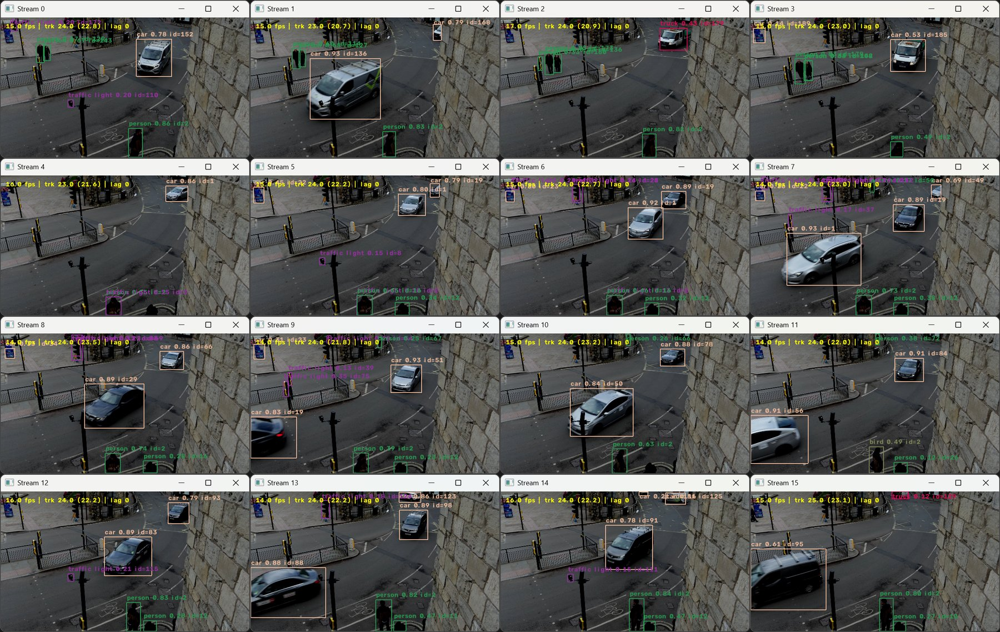
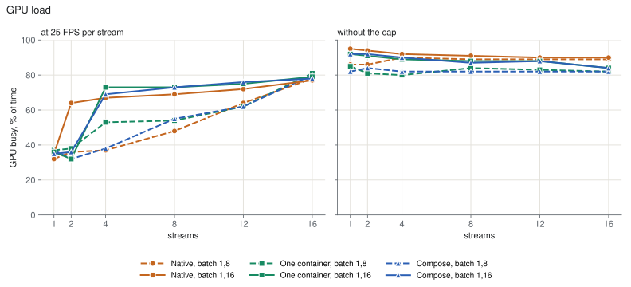
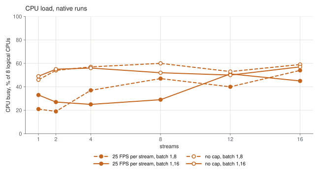
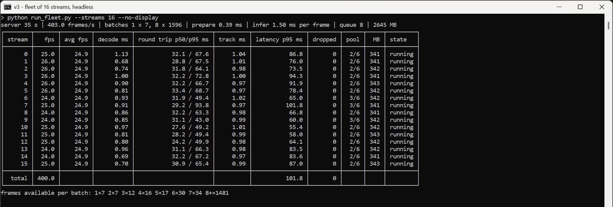
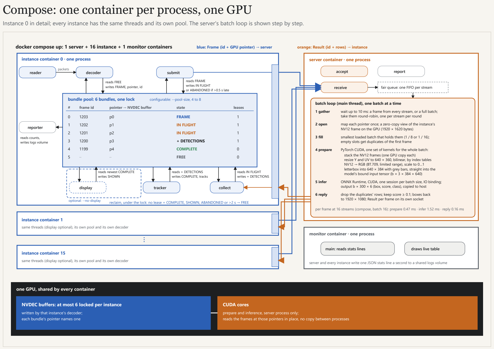

# multistream-gpu-inference

Real-time object detection and tracking for many video streams on one NVIDIA GPU. Every stream runs in its own
process: it decodes the video on the GPU (NVDEC), tracks the detected objects (ByteTrack) and can show them in a
window. One inference server batches the frames of all streams and runs YOLO26n in ONNX Runtime with CUDA. Frames never
leave the GPU: a process hands the server a frame id and a GPU pointer, not the image. The application runs natively on
Windows or in Linux containers, either all in one container or one container per process with Docker Compose.

On one GeForce RTX 2070 SUPER (8 GB), 16 streams of 1080p video at 25 FPS each, 400 frames a second in total, run with
no frame dropped, natively and in containers.



## Performance

Measured on 2026-11-06 on the machine under [Requirements](#requirements), headless, one test clip (1920x1080, 25 FPS),
2 loops per stream, one run per point. Three ways to run: **native** (Windows processes), **one container** (the whole
fleet in the server image) and **compose** (one container per process). Each runs with the server's batch sizes `1,8`
(the default) or `1,16`.


At 16 streams:

| Mode | Batch sizes | Total FPS at 25 FPS per stream | Dropped frames | p95 latency, ms | Capacity, FPS |
| --- | --- | --- | --- | --- | --- |
| Native | 1,8 | 401.9 | 0 | 74.8 | 459.8 |
| Native | 1,16 | 401.8 | 0 | 90.9 | 491.4 |
| One container | 1,8 | 395.9 | 177 | 724.0 | 386.6 |
| One container | 1,16 | 404.1 | 0 | 119.6 | 419.3 |
| Compose | 1,8 | 384.3 | 730 | 743.3 | 391.3 |
| Compose | 1,16 | 403.7 | 0 | 83.0 | 424.5 |

- Natively both batch sets hold 16 streams. `1,8` has the lower latency, `1,16` the higher capacity.
- In containers 16 streams need `1,16`: with `1,8` the containers fall short of 400 FPS and drop frames.
- Capacity is the total FPS without the 25 FPS cap (`--pace max`).
- Latency runs from a frame's due time to the end of its tracking. The figure is the slowest stream's p95.
- With one window per stream (native), 25 FPS holds up to 4 windows with no frame dropped. 16 windows reach 371.9 FPS in
  total.

### Load and memory






At 16 streams:

| Mode | Batch sizes | GPU busy at 25 FPS per stream, % | GPU busy without the cap, % | GPU memory, MB | CPU at 25 FPS per stream, % |
| --- | --- | --- | --- | --- | --- |
| Native | 1,8 | 78 | 89 | 3373 | 54 |
| Native | 1,16 | 77 | 90 | 3725 | 45 |
| One container | 1,8 | 81 | 82 | 3351 | not measured |
| One container | 1,16 | 79 | 84 | 3697 | not measured |
| Compose | 1,8 | 80 | 82 | 3411 | not measured |
| Compose | 1,16 | 78 | 84 | 3703 | not measured |

- **GPU busy** is the share of time the card ran any kernel (NVML), averaged over the run. It does not show how full
  the GPU's units were. At 25 FPS per stream, 16 streams keep the card about 80% busy. Without the cap it stays at 80 to
  95% from 1 stream up, so the GPU is the limit.
- **GPU memory** is the application's share of the card: the peak during the run minus the memory other programs held
  before it (3.4 to 3.5 GB in these runs). It comes from the runs without the cap, the only ones that recorded the
  memory in use before. It grows by about 160 MB per stream, and `1,16` adds about 350 MB for the server's batch 16
  model. At 16 streams natively with `1,8`, the server held 1051 MB and each instance 156 MB.
- **CPU** is the host's 8 logical CPUs, sampled natively only. In the one-container run with `1,8` at 25 FPS per stream,
  the container used 56% of the Docker VM's 4 CPUs at 16 streams; the other container runs did not sample the CPU.

<details>
<summary>All points of the charts</summary>

| Capacity, total FPS | 1 | 2 | 4 | 8 | 12 | 16 |
| --- | --- | --- | --- | --- | --- | --- |
| Native, 1,8 | 192.7 | 361.8 | 467.1 | 467.3 | 464.0 | 459.8 |
| One container, 1,8 | 164.1 | 297.8 | 385.8 | 403.9 | 394.2 | 386.6 |
| Compose, 1,8 | 163.2 | 307.3 | 394.8 | 392.0 | 391.1 | 391.3 |
| Native, 1,16 | 108.0 | 207.4 | 406.0 | 493.0 | 492.2 | 491.4 |
| One container, 1,16 | 99.3 | 189.8 | 349.3 | 441.0 | 439.7 | 419.3 |
| Compose, 1,16 | 98.4 | 189.4 | 352.5 | 437.0 | 439.9 | 424.5 |

| p95 latency at 25 FPS per stream, ms | 1 | 2 | 4 | 8 | 12 | 16 |
| --- | --- | --- | --- | --- | --- | --- |
| Native, 1,8 | 36.9 | 37.7 | 52.8 | 63.7 | 63.1 | 74.8 |
| One container, 1,8 | 32.5 | 32.1 | 51.2 | 53.6 | 57.0 | 724.0 |
| Compose, 1,8 | 33.5 | 52.7 | 42.8 | 53.3 | 58.9 | 743.3 |
| Native, 1,16 | 33.2 | 46.1 | 62.5 | 76.8 | 81.6 | 90.9 |
| One container, 1,16 | 33.3 | 56.6 | 68.2 | 75.2 | 72.2 | 119.6 |
| Compose, 1,16 | 33.8 | 62.5 | 44.6 | 73.8 | 75.0 | 83.0 |

At 25 FPS per stream every series holds 25 FPS with no frame dropped up to 12 streams.

| GPU busy at 25 FPS per stream, % | 1 | 2 | 4 | 8 | 12 | 16 |
| --- | --- | --- | --- | --- | --- | --- |
| Native, 1,8 | 32 | 36 | 37 | 48 | 64 | 78 |
| One container, 1,8 | 37 | 38 | 53 | 54 | 62 | 81 |
| Compose, 1,8 | 37 | 32 | 38 | 55 | 62 | 80 |
| Native, 1,16 | 35 | 64 | 67 | 69 | 72 | 77 |
| One container, 1,16 | 36 | 32 | 73 | 73 | 75 | 79 |
| Compose, 1,16 | 35 | 36 | 69 | 73 | 76 | 78 |

| GPU busy without the cap, % | 1 | 2 | 4 | 8 | 12 | 16 |
| --- | --- | --- | --- | --- | --- | --- |
| Native, 1,8 | 86 | 86 | 90 | 89 | 89 | 89 |
| One container, 1,8 | 85 | 81 | 80 | 84 | 83 | 82 |
| Compose, 1,8 | 82 | 84 | 82 | 82 | 82 | 82 |
| Native, 1,16 | 95 | 94 | 92 | 91 | 90 | 90 |
| One container, 1,16 | 92 | 91 | 89 | 88 | 88 | 84 |
| Compose, 1,16 | 92 | 92 | 90 | 87 | 88 | 84 |

| GPU memory used by the application, MB | 1 | 2 | 4 | 8 | 12 | 16 |
| --- | --- | --- | --- | --- | --- | --- |
| Native, 1,8 | 974 | 1128 | 1449 | 2089 | 2777 | 3373 |
| One container, 1,8 | 797 | 961 | 1301 | 1987 | 2709 | 3351 |
| Compose, 1,8 | 797 | 961 | 1319 | 1981 | 2667 | 3411 |
| Native, 1,16 | 1330 | 1484 | 1813 | 2445 | 3085 | 3725 |
| One container, 1,16 | 1153 | 1317 | 1657 | 2337 | 3023 | 3697 |
| Compose, 1,16 | 1153 | 1317 | 1657 | 2359 | 3023 | 3703 |

| CPU, native, % of 8 logical CPUs | 1 | 2 | 4 | 8 | 12 | 16 |
| --- | --- | --- | --- | --- | --- | --- |
| 25 FPS per stream, 1,8 | 21 | 19 | 37 | 47 | 40 | 54 |
| 25 FPS per stream, 1,16 | 33 | 27 | 25 | 29 | 51 | 45 |
| Without the cap, 1,8 | 46 | 54 | 57 | 60 | 53 | 59 |
| Without the cap, 1,16 | 49 | 55 | 56 | 52 | 50 | 57 |

</details>

Every table, the GPU load, the runs with windows and the method are in
[docs/performance-and-design.md](docs/performance-and-design.md).

## Requirements

- An NVIDIA GPU with a current driver. Measured on a GeForce RTX 2070 SUPER (8 GB, driver 616.56), an Intel Core
  i7-9700K, 32 GB RAM, Windows 11.
- Containers on Windows: Docker Desktop with the WSL2 back end, and PowerShell 7.3 or later.
- Containers on Ubuntu 24.04: Docker with the buildx plugin and the NVIDIA Container Toolkit. The build script is
  checked but has not run on a real Ubuntu host.
- Native run: Windows and Python 3.14.

## Build and run

### In containers

1. Build the images. The script fetches the test clip, exports the models in a container, builds the images
   `traffic-v3:server` and `traffic-v3:instance`, and smoke-tests them:

   ```powershell
   pwsh tools/build_images.ps1        # Windows
   ```

   ```bash
   tools/build_images.sh              # Ubuntu 24.04
   ```

2. Set the key that authenticates the processes to each other. Set it in every shell that runs `docker compose`:

   ```powershell
   $env:TRAFFIC_INFERENCE_KEY = [Convert]::ToHexString([Security.Cryptography.RandomNumberGenerator]::GetBytes(32))
   ```

   ```bash
   export TRAFFIC_INFERENCE_KEY=$(openssl rand -hex 32)
   ```

3. Run the server, 16 instances and the monitor, and watch the live table from a second shell:

   ```powershell
   docker compose up --abort-on-container-failure
   docker compose logs -f monitor     # second shell, same key
   ```

   For 16 streams with no frame dropped, use batch sizes `1,16`. Save this as `compose.b16.yaml` and start with
   `docker compose -f compose.yaml -f compose.b16.yaml up --abort-on-container-failure`:

   ```yaml
   services:
     server:
       command: ["python", "run_server.py", "--address", "/run/traffic/server.sock", "--clients", "16", "--batch-sizes", "1,16", "--stats-file", "/logs/server.log"]
   ```

4. Stop and clean up after each run: `docker compose down -v`.

To run the whole fleet in one container instead:

```powershell
docker run --rm -it --gpus all --cap-add SYS_PTRACE traffic-v3:server `
  python run_fleet.py --streams 16 --no-display --batch-sizes 1,16 --input /data/pexels-36304379.mp4
```

### Natively on Windows

From the repository root, in PowerShell:

```powershell
py -3.14 -m venv .venv
.venv\Scripts\python.exe -m pip install -r requirements.txt
.venv\Scripts\python.exe download_clip.py              # the test clip, data\pexels-36304379.mp4
.venv\Scripts\python.exe tools\export_models.py        # the models, models\b1, b4, b8 and b16.onnx

.venv\Scripts\python.exe run_fleet.py --streams 4                  # 4 windows and a live table
.venv\Scripts\python.exe run_fleet.py --streams 16 --no-display    # 16 streams, headless
```

The live table shows every stream's FPS, stage times, latency, dropped frames and memory, and the server's batches:



Other stream counts, mounts, options and the benchmark script are described in
[Running in detail](docs/performance-and-design.md#running-in-detail).

## Architecture



- **Instance, one process per stream.** It reads and decodes its stream on the GPU and keeps each frame in a pool of 6
  bundles. It sends the server the frame id and GPU pointer, tracks the detections that come back and can show the
  stream in a window. An instance loads neither PyTorch nor the model.
- **Inference server, one process.** It holds the model once. It gathers frames from all streams for up to 10 ms and
  reads them in place on the GPU. It prepares and infers them as one batch and sends each stream its detections.
- **Monitor.** It reads the one-line JSON statistics that every process writes each second and draws the live table.

The diagram shows the compose layout. Natively the same processes run on Windows and talk over named pipes instead of
Unix sockets. The per-frame times in the diagram are from a compose run of 2026-11-05. The design, the decisions and the
measurements behind them are in [docs/performance-and-design.md](docs/performance-and-design.md) and
[docs/design/](docs/design).

## Versions

| Version | Branch | Design |
| --- | --- | --- |
| v1 | [v1-single-stream](https://github.com/BarabashkaD/multistream-gpu-inference/tree/v1-single-stream) | One process per stream, each with its own model |
| v2 | [v2-bundle-pipeline](https://github.com/BarabashkaD/multistream-gpu-inference/tree/v2-bundle-pipeline) | One stream per process as a threaded pipeline of bundles |
| v3 | `main` (this branch) | One batching inference server for all streams |

## Candidate verification

[GPU verification and deferred release](docs/CANDIDATE_VERIFICATION.md) describes the
immutable-image smoke test, retained CPU evidence and remaining distribution checks.
GPU automation is disabled by default; PR CI does not publish images.
The manual [GHCR release workflow](docs/ghcr-release.md) builds and publishes both
checked images and adds their digest links to a GitHub prerelease. First-time
GHCR packages default to private; public visibility is a one-time package setting.

## Contributing

See [CONTRIBUTING.md](CONTRIBUTING.md).

## License

Licensed under the GNU Affero General Public License, version 3 or (at your option) any later version
([LICENSE](LICENSE)), with the additional terms in [NOTICE](NOTICE): author attribution, marking of modified
versions, and permission to combine the program with NVIDIA libraries. Ultralytics and YOLO26 are licensed under
AGPL-3.0. The licenses of the dependencies are in [THIRD_PARTY_NOTICES.md](THIRD_PARTY_NOTICES.md).

The test clip is Pexels video 36304379, "Busy urban intersection from above", subject to the Pexels license (see
[NOTICE](NOTICE)). It is not part of the repository.

Copyright (C) 2026 Dmitry Veremeev

To cite this software, use [CITATION.cff](CITATION.cff).
