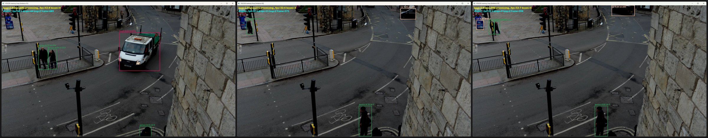
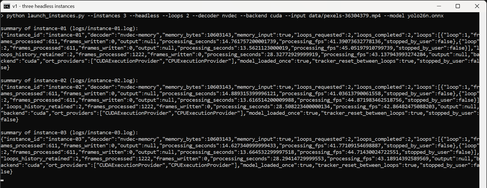
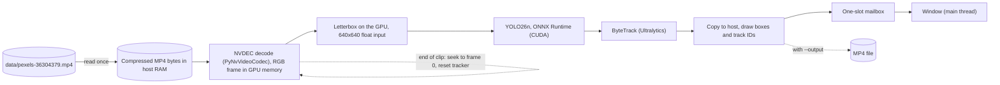

# multistream-gpu-inference, v1: single stream

This branch keeps v1, the first version of this project. The current version is on the
[main branch](https://github.com/BarabashkaD/multistream-gpu-inference); the next one is
[v2-bundle-pipeline](https://github.com/BarabashkaD/multistream-gpu-inference/tree/v2-bundle-pipeline).

v1 runs object detection and tracking on one video stream per process, on an NVIDIA GPU. It reads the compressed MP4
once into RAM, decodes it on the GPU (NVDEC), letterboxes each frame on the GPU, detects with YOLO26n in ONNX Runtime
with CUDA and tracks with Ultralytics ByteTrack, one frame after another. It can show the stream in a window or record
it to MP4. Several streams are several independent processes, each with its own model.

On one GeForce RTX 2070 SUPER (8 GB), one process runs at about 112 FPS; all processes together reach about 135 FPS,
and up to 5 processes each still run faster than the clip's 25 FPS.



## Performance

Measured on 2026-11-06 on the machine under [Requirements](#requirements): one stream per process, headless, one test
clip (1920x1080, 25 FPS), 3 loops per process with the first left out (it includes loading the model), one run per
point. v1 has no pacing: every process runs as fast as it can.


| Load | Total FPS | Slowest process, FPS | Time per frame, ms | GPU busy, % | CPU, % | GPU memory, MB |
| --- | --- | --- | --- | --- | --- | --- |
| 1 process | 111.7 | 111.7 | 9.0 | 40 | 42 | 380 |
| 2 processes: the highest total | 135.2 | 67.4 | 14.8 | 83 | 57 | 756 |
| 5 processes: the most above 25 FPS each | 132.2 | 26.3 | 38.0 | 94 | 90 | 1884 |
| 8 processes | 126.3 | 15.4 | 65.1 | 94 | 100 | 2964 |

- **The limit.** From 2 processes the total stays at about 132 to 135 FPS: each process runs its own model one frame
  at a time, and the GPU is 83 to 95% busy. From 6 processes the CPU is at 100% too, and at 8 the total dips to 126.
- **One process** reaches 111.7 FPS with the GPU only 40% busy: decoding, preparation, inference, tracking and drawing
  run one after another, so its own serial path limits it.
- **Time per frame** is 1000 divided by the FPS of the slowest process. v1 records no latency from a frame's due time.
- **GPU busy** is the share of time the card ran any kernel. **CPU** counts all 8 logical CPUs.
- **GPU memory** is the card's peak minus the memory other programs held before the run (3284 MB). Each process adds
  about 380 MB of GPU memory and about 1.3 GB of host memory: its own decoder, model, session and tracker.
- **With windows** (a run earlier the same day), 1, 2 and 3 processes reach about 85, 108 and 110 FPS in total; with
  three the GPU is 96 to 98% busy.

<details>
<summary>All points of the charts</summary>

| Processes | 1 | 2 | 3 | 4 | 5 | 6 | 7 | 8 |
| --- | --- | --- | --- | --- | --- | --- | --- | --- |
| Total FPS | 111.7 | 135.2 | 132.7 | 133.5 | 132.2 | 131.6 | 132.5 | 126.3 |
| Slowest process, FPS | 111.7 | 67.4 | 44.0 | 33.2 | 26.3 | 21.9 | 18.8 | 15.4 |
| Time per frame of the slowest process, ms | 9.0 | 14.8 | 22.7 | 30.1 | 38.0 | 45.8 | 53.2 | 65.1 |
| GPU busy, % | 40 | 83 | 91 | 94 | 94 | 95 | 95 | 94 |
| NVDEC, % | 6 | 7 | 8 | 8 | 8 | 8 | 8 | 7 |
| CPU, % | 42 | 57 | 67 | 80 | 90 | 100 | 100 | 100 |
| GPU memory, MB | 380 | 756 | 1132 | 1508 | 1884 | 2260 | 2636 | 2964 |

The one-process run is about 22 s long, so its GPU and CPU means include loading the model.

</details>

Every table, the runs with windows and the method are in
[docs/performance-and-design.md](docs/performance-and-design.md).

## Requirements

- An NVIDIA GPU with a current driver. Measured on a GeForce RTX 2070 SUPER (8 GB, driver 616.56), an Intel Core
  i7-9700K, 32 GB RAM, Windows 11.
- Windows with Python 3.14 (measured). On Linux the commands were tested under WSL2.
- PyNvVideoCodec 2.2.3; `requirements-windows-plan.txt` pins it with the other packages.

## Build and run

From the repository root, in PowerShell:

```powershell
.\setup_windows.ps1                       # creates .venv and installs the packages
.\.venv\Scripts\Activate.ps1
python download_clip.py                   # the test clip, data\pexels-36304379.mp4
python prepare_model.py                   # the model, yolo26n.onnx

.\run_windows.ps1 --instances 1 --loops 2 --decoder nvdec --backend cuda              # one stream in a window
.\run_windows.ps1 --instances 3 --headless --loops 3 --decoder nvdec --backend cuda   # three streams, headless
```

`run_windows.ps1` starts the given number of independent processes, one log each. At the end every process prints a
JSON summary with the FPS of each loop:



Press Q or Esc, or close the window, to stop. The Linux commands, recording to MP4 and every option are in
[Running in detail](docs/performance-and-design.md#running-in-detail).

## Architecture



- **One frame at a time.** Decoding, preparation, inference and tracking run one after another on one thread.
  The decoded frame stays on the GPU until it has to be drawn.
- **A window never slows inference.** The window takes frames from a one-slot mailbox on the main thread, so a slow
  display drops display frames, never processed ones.
- **One process, one stream, one model.** More streams mean more processes, each with its own decoder, model and
  session: that duplication is what the next versions remove.

The program in detail is in [docs/performance-and-design.md](docs/performance-and-design.md#what-this-version-does).

## Versions

| Version | Branch | Design |
| --- | --- | --- |
| v1 | `v1-single-stream` (this branch) | One process per stream, each with its own model |
| v2 | [v2-bundle-pipeline](https://github.com/BarabashkaD/multistream-gpu-inference/tree/v2-bundle-pipeline) | One stream per process as a threaded pipeline of bundles |
| v3 | [main](https://github.com/BarabashkaD/multistream-gpu-inference/tree/main) | One batching inference server for all streams |

## License

Licensed under the GNU Affero General Public License, version 3 or (at your option) any later version
([LICENSE](LICENSE)), with the additional terms in [NOTICE](NOTICE): author attribution, marking of modified
versions, and permission to combine the program with NVIDIA libraries. Ultralytics and YOLO26 are licensed under
AGPL-3.0. The licenses of the dependencies are in [THIRD_PARTY_NOTICES.md](THIRD_PARTY_NOTICES.md).

The test clip is Pexels video 36304379, "Busy urban intersection from above", subject to the Pexels license (see
[NOTICE](NOTICE)). It is not part of the repository.

Copyright (C) 2026 Dmitry Veremeev

To cite this software, use [CITATION.cff](CITATION.cff).

## Temporal batching (v1)

`--batch-size N` (default **1**) groups successive frames of **one video stream**
into one inference. Each process still owns its own model. ByteTrack advances once
per real frame, in order, and persists between batches; it resets between loops.
The square 640x640 input and existing confidence settings are unchanged.

Export a matching static model, then select it explicitly:

```powershell
python prepare_model.py --model yolo26n.pt --batch-size 4
python run_demo.py --input data/pexels-36304379.mp4 --model yolo26n-b4.onnx --batch-size 4 --no-display
python launch_instances.py --instances 2 --model yolo26n-b4.onnx --batch-size 4 --headless
```

The PowerShell launchers forward `--batch-size` unchanged. N must be positive.
A model/input shape mismatch fails before processing instead of silently splitting
one requested batch into multiple batch-1 calls. Non-default exports use a separate
`-bN.onnx` file and do not overwrite the batch-1 model. Dynamic models are not supported.

EOF, max-frames and graceful stop flush the real partial batch before resetting the
tracker. Ultralytics **8.4.190** pads the static model input internally and removes
padding outputs before tracking. No artificial frames are recorded or counted.
Ctrl-C (and launcher Ctrl-Break on Windows) requests a graceful stop in headless mode;
an exception or forced process termination does not guarantee a flush.

By default files are decoded as fast as possible (`--pace max`). With `--pace realtime`
(see [Real-time pacing](#real-time-pacing-v1)) batch 8 adds up to 280 ms of accumulation
wait at 25 FPS (140 ms on average), plus processing. Larger batches also require more GPU memory and can make
multi-process scaling worse. Batching concatenates prepared GPU tensors; it is not
a zero-copy change.

MP4 recording includes every real processed frame in order at the source FPS.
The existing newest-frame GUI mailbox may skip more displayed frames when results
arrive in bursts; this does not mean inference skipped frames.

JSON reports `batch_size`, `model_input_shape`, per-loop `frames_read`,
`frames_processed`, `frames_written`, `inference_batches`, `batch_sizes`,
`batch_fill_wait_ms`, and `read_to_batch_complete_ms` p50/p95. The latter ends when
all tracking callbacks in that batch finish, not each individual tracker update.
Latency statistics retain the last 4096 frames per loop; initial model warmup is
included. `inference_batches` counts application calls, excluding model warmup.

Run tests with the environment from requirements.txt:

```powershell
python -m unittest discover -s tests -v
$env:V1_BATCH_MODEL = 'C:\absolute\path\yolo26n-b4.onnx'
$env:V1_BATCH_CLIP = 'C:\absolute\path\clip.mp4'
$env:V1_BATCH_SIZE = '4'
python -m unittest discover -s tests -p test_real_batch_contract.py -v
```

The opt-in GPU test instruments actual ONNX Runtime calls and tracker updates,
including a partial tail and a second loop. Benchmark speed separately using equal
clip/confidence/warmup/loop settings and multiple repeats; unit tests do not prove
throughput gains or detection accuracy equivalence.

### Model input size (v1)

`--imgsz` accepts one square size or two numbers in **height width** order.
The default remains `--imgsz 640` (640×640). It is independent of `--batch-size`
(default 1). Dimensions must be positive multiples of 32. Select a size at
process startup; a running static ONNX session does not switch shapes.

```powershell
python prepare_model.py --model yolo26n.pt --imgsz 384 640 --batch-size 4
python run_demo.py --input data/pexels-36304379.mp4 --model yolo26n-640x384-b4.onnx --imgsz 384 640 --batch-size 4 --no-display
```

The launcher accepts the same arguments. Export one static model per size and
batch combination. Square default models retain `yolo26n.onnx` / `yolo26n-b4.onnx`;
rectangular models use `yolo26n-640x384.onnx` / `yolo26n-640x384-b4.onnx`
(filenames use width×height). Export is isolated and validated before replacing
its destination. Runtime rejects mismatched graph shape, dtype or batch/size
metadata before opening the decoder; re-export legacy models with missing metadata.

For 1920×1080 video, both inputs contain a resized 640×360 image without crop or
stretch. 640×384 reduces the top/bottom padding from 140 to 12 pixels each.
The model input has 40% fewer pixels, but speedup and equal detection quality
are **not guaranteed**. A portrait or 4:3 source may lose useful input resolution;
640×384 is not a universal replacement for the square default.

CPU and CUDA preprocessing use centered letterbox; boxes/tracks remain in the
original image coordinates. Display and MP4 dimensions are unchanged. JSON includes
`input_height`, `input_width` and `model_input_shape`. Tail batches and tracker
updates retain the temporal-batching contract.

Validation commands (CPU unit tests, no media/GPU required for shape/export tests):

```powershell
python -m unittest discover -s tests -p test_input_shape.py -v
python -m unittest discover -s tests -p test_export_cli.py -v
```

The opt-in real GPU contract additionally accepts `V1_BATCH_IMGSZ="384 640"`
and needs `V1_BATCH_MODEL`, `V1_BATCH_SIZE`, `V1_BATCH_CLIP` to match. GPU export,
real inference, GUI and accuracy/performance comparisons for this size change are
pending. Compare shapes at the same batch first, using the same checkpoint,
provider, clip, thresholds, warmup and repeated runs. Compare FPS, memory and
latency separately; prediction agreement against square input is not ground-truth
accuracy. Do not reuse the earlier batching-only FPS numbers as evidence for this
change.

### Real-time pacing (v1)

`--pace realtime` reads each frame no earlier than its source time: frame *k* of a
loop is due *k* ÷ clip FPS after the loop starts (40 ms apart for the 25 FPS clip),
as a live camera would deliver it. The default `--pace max` keeps the original
behaviour: every frame as fast as possible.

`--drop-policy oldest` (real time only) skips a frame read more than the lateness
limit after its due time. The frame is still decoded, to keep the stream position,
but it is neither inferred, tracked nor recorded, so ByteTrack sees a gap. The
default `--drop-policy none` processes every frame, late or not.

`--max-lag-s S` is the only lateness option. By default the limit is 1.1 frame
periods of the clip being read, 1.1 ÷ clip FPS: 44 ms at 25 FPS. A frame is then
dropped once the next one is already due, with 10% tolerance for jitter, so the
process always works on a current frame, at the cost of dropping as soon as it
falls behind, even briefly. An explicit value, such as `--max-lag-s 0.5`, is used
as given and must be greater than 0; a longer limit tolerates short slowdowns.
`launch_instances.py` forwards `--max-lag-s` only when it is given, so by default
each process computes the limit from its own clip's FPS.

**v2 and v3 use a fixed 0.5 s default**, so v1 now drops earlier than they do by
default. Pass `--max-lag-s 0.5` to compare v1 with them on equal terms.

```powershell
python run_demo.py --input data/pexels-36304379.mp4 --model yolo26n.onnx --pace realtime --no-display
python launch_instances.py --instances 4 --headless --pace realtime --drop-policy oldest
python launch_instances.py --instances 4 --headless --pace realtime --drop-policy oldest --max-lag-s 0.5
```

Per loop, JSON adds `due_to_tracked_ms` p50/p95, from the frame's due time to the end
of its batch's tracking, `frames_dropped` and the limit in force when dropping is
on, `max_lag_ms` (null otherwise). The summary adds `pace`, `drop_policy`, the
effective limit in seconds, `max_lag_s`, and the total `frames_dropped`. At max pace the due time is the moment the
frame was read, so `due_to_tracked_ms` equals `read_to_batch_complete_ms`. This is the
latency definition v2 and v3 use at 25 FPS.

The model is loaded on the first frame of loop 1, so with `--drop-policy oldest` the
first few frames of loop 1 can be dropped; leave loop 1 out of measurements. CPU tests:
`python -m unittest discover -s tests -p test_pacing.py -v`.
