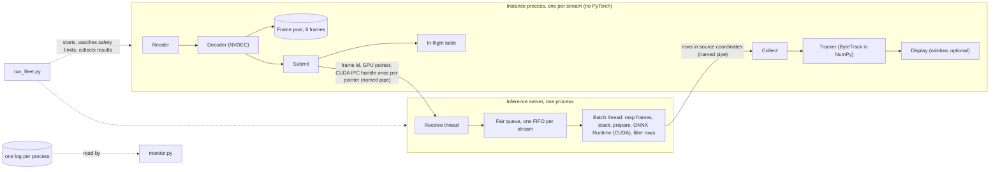

# Performance and design in detail

The [README](../README.md) gives the short version: what the application does, how to build and run it, the charts and
the architecture diagram. This document holds the rest: the conditions of the measurements, every table, the history
of the three versions, the optimisations, what was tried and rejected, the limits and the security notes.

## Test machine

Every figure in this document was measured on 2026-11-06 on Windows 11 with an NVIDIA GeForce RTX 2070 SUPER (8 GB,
driver 616.56), an Intel Core i7-9700K (8 cores, 8 threads) and 32 GB RAM, on one test clip (1920x1080, 25 FPS, 611
frames), over 2 loops per stream unless stated. About 3.5 GB of the card's memory was in use by other programs during
those runs. The container figures come from Docker Desktop with the WSL2 back end on the same computer, in a VM with 4
CPUs and 7.66 GiB. A real Ubuntu host is untested: the bash build script was checked with ShellCheck
and dry-run with a stub `docker` in an Ubuntu 24.04 container, but it has not run on a real Ubuntu host. The two images
saved to one file take about 6.5 GB.

## Running in detail

### Containers

The images are self-contained: both hold the clip, and the server image holds the models. `compose.yaml` mounts no
host folder, only named volumes for the sockets and the logs. To use the host's models and clip instead, add the
mounts file: `docker compose -f compose.yaml -f compose.mounts.yaml up --abort-on-container-failure`. For another
stream count, `tools/make_compose.py --streams N --output PATH --mounts-output MOUNTS_PATH` writes a new pair of files;
pass them with `-f PATH --project-directory .`, and do not overwrite the committed pair, which a test compares with the
16-stream output.

In the container runs of 2026-11-06, compose held 25 FPS on every stream up to 12 streams but not at 16: with the
default batch sizes `1,8` it reached 384.3 FPS in total and dropped 730 frames. With batch sizes `1,16` it held 25 FPS
on every stream at 16 streams, with 403.7 FPS in total and no frame dropped; one container did the same (404.1 FPS, no
frame dropped). See [In containers](#in-containers-25-fps-per-stream) and
[Batch sizes 1,8 and 1,16](#batch-sizes-18-and-116). The older compose runs are in the dated
[Earlier measurements](design/containers-live-stats.md#earlier-measurements-2026-11-05-and-before) section.
For containers at 16 streams use `1,16`; natively `1,8` stays the default. To run with `1,16`, save this as `compose.b16.yaml` and add `-f compose.b16.yaml` after `-f compose.yaml`:

```yaml
services:
  server:
    command: ["python", "run_server.py", "--address", "/run/traffic/server.sock", "--clients", "16", "--batch-sizes", "1,16", "--stats-file", "/logs/server.log"]
```

The whole fleet also runs in one server container. `SYS_PTRACE` is required for sharing frames, `-it` shows the live
table, and only the results are mounted:

```powershell
docker run --rm -it --gpus all --cap-add SYS_PTRACE -v "${PWD}/results:/app/results" `
  traffic-v3:server python run_fleet.py --streams 2 --no-display --input /data/pexels-36304379.mp4
```

Inside the images the clip is at `/data/pexels-36304379.mp4`, outside the `/app` folder that holds the code, so pass
`--input` as above; compose passes it to every instance.

### Console run (Windows)

`export_models.py` exports `yolo26n.pt` (or `--weights`) on the CPU; Ultralytics downloads the weights by name if
they are missing. Useful options of `run_fleet.py`: `--streams N`, `--no-display`, `--loops N` (passes over the clip,
default 2), `--pace max` (no 25 FPS cap), `--screen WIDTHxHEIGHT` (window grid size), `--batch-sizes 1,8`,
`--monitor-period-s S` (live table refresh, 0 = off), `--input PATH`.

The live table shows every stream's FPS, stage times, latency, drops, frame pool and memory, plus the server's batches
and a histogram of frames available per batch. To redraw it from the logs, or in a second window:

```powershell
.venv\Scripts\python.exe monitor.py --logs results\latest           # live
.venv\Scripts\python.exe monitor.py --logs results\latest --once    # one table
```

`run_fleet.py` makes a fresh pipe key for each run, writes one log per process and `summary.json` to
`results\latest\`, and stops every process if free GPU memory falls below 300 MB or available host memory below 1 GB.

## The journey

Each version is kept on its own branch as a single commit.

| Version | What changed | Measured result | Bottleneck that forced the next step | Commit |
| --- | --- | --- | --- | --- |
| [v1](https://github.com/BarabashkaD/multistream-gpu-inference/tree/v1-single-stream) | One process per stream. The compressed MP4 is read once into host RAM and decoded with NVDEC (PyNvVideoCodec); YOLO26n runs in ONNX Runtime with CUDA; Ultralytics ByteTrack tracks. Several streams are several independent processes | 1 process headless: about 110 FPS. With windows, 1, 2 and 3 processes: about 85, 108 and 110 FPS combined; with three the GPU is 96-98% busy and NVDEC about 6% | Every process holds its own model and session, so GPU memory is duplicated, and runs one frame at a time. At three processes GPU compute is the limit: three processes with windows together reach about what one headless process does | [c2be9d1](https://github.com/BarabashkaD/multistream-gpu-inference/commit/c2be9d1cc28e7400d9996964766ceebaae6c4617) single commit |
| [v2](https://github.com/BarabashkaD/multistream-gpu-inference/tree/v2-bundle-pipeline) | One stream in one process, as a pipeline: reader, decoder, prepare, inference, tracker and display threads pass bundles from a fixed pool. Decoded frames travel with no further copy before inference; display draws through OpenGL | 1 process headless with tracking, max pace, 3 loops: `steady_fps.tracked` 146.5 in two runs. One process per stream at 25 FPS: headless, 6 processes hold 25 FPS with the GPU 93% and the CPU 96% busy, and 8 were stopped by the GPU memory safety limit at about 18.6 FPS; with windows, 4 hold 25 FPS (6 or more not tested). Each process adds about 0.5 GB of GPU memory | One process still runs one frame at a time through inference, and every process holds its own model. At 6 processes GPU and CPU are both near their limits, and with 8 processes free GPU memory fell below the safety limit | [3a29e3b](https://github.com/BarabashkaD/multistream-gpu-inference/commit/3a29e3b742320c5943cf4d80e9f5c2ea3483e98d) single commit |
| v3 (this branch) | One inference server batches frames from all streams; one process per stream decodes, tracks and shows it. Frames cross processes as GPU pointers through CUDA IPC. The model input is 640x384, and the tracker is a NumPy port, so instances load no PyTorch. Containers, live statistics, gathered and padded batches | 16 streams at 25 FPS, 401.9 FPS in total headless, GPU 78%, no frame dropped. With one window per stream, 4 hold 25 FPS and 16 reach 371.9 FPS. Capacity at max pace, natively with `1,8`: 459.8 FPS at 16 streams | The batch thread prepares and infers one batch after another, and at max pace the GPU is the limit from 4 streams up. At 16 streams capacity is 15% above the 400 FPS needed. With windows, 12 streams fall just below 25 FPS and 16 do not hold it | single commit (this branch) |

All three rows were measured on 2026-11-06 on the computer described in [Test machine](#test-machine), each version
from its own branch; for v1 and v2, `nvidia-smi dmon` and `typeperf` sampled once a second. A v1 rate leaves out the
first loop, which includes loading the model, and the three v1 processes overlapped for about 75 s. In the v2 runs with
several processes each process ran one stream over 2 loops, and about 3.5 GB of the card's memory was in use by other
programs. The design of v3 is in
[docs/design/external-inference.md](design/external-inference.md), and the containers and live statistics in
[docs/design/containers-live-stats.md](design/containers-live-stats.md).

## Architecture



| Process | What it does |
| --- | --- |
| Instance (`run_instance.py`, `pipeline/`) | Reads and decodes one stream with NVDEC, sends each frame's GPU pointer to the server, tracks the returned detections and shows the stream in its own window, or none with `--no-display` |
| Inference server (`run_server.py`, `server/`) | Holds the models, one ONNX Runtime session per batch size. Gathers frames from every stream, converts and letterboxes them on the GPU, detects, and returns each stream its rows |
| Fleet (`run_fleet.py`) | Starts one server and N instances with a fresh pipe key, watches the safety limits and writes `summary.json` |
| Monitor (`monitor.py`) | Reads the log files and draws one table of every process; it never talks to the server |

The boundaries follow the costs. GPU compute needs one owner to batch it, so the model, preparation and PyTorch live
in the server, once. Tracking is per-stream Python work that would compete for the server's interpreter lock, so it
stays in the instance with that stream's state. Decoding stays in the instance because NVDEC has spare capacity and the
decoded frame must stay available for that instance's window. An instance imports neither PyTorch nor ONNX Runtime,
which a test enforces. The tracker in `pipeline/bytetrack.py` is a port of the Ultralytics ByteTrack tracker to NumPy,
held to Ultralytics' results frame by frame: a test requires identical IDs and boxes within 0.01 pixels. The instance
cannot use Ultralytics' own tracker, because importing it loads PyTorch into every instance; the private memory that
costs was measured in the design phase and is in [docs/design/external-inference.md](design/external-inference.md#tracker).

Messages are pickled over one authenticated named pipe per instance (a Unix socket on Linux). The server sends `Start`
once every expected instance has joined, so all streams start together, and sends `Closed` when it has closed a
stream's handles, so the instance may destroy its decoder.

## How a frame travels

The times below are from the 16-stream headless run at 25 FPS per stream of 2026-11-06.

1. The instance's decoder writes the frame into decoder memory. The median decode time per instance was 0.71 to
   0.87 ms.
2. Submit sends the frame id and its GPU pointer over the instance's named pipe. The first time a pointer appears it
   also sends a CUDA IPC handle for it, so the frame itself is never copied between processes.
3. The server gathers frames (up to 10 ms, stopping at a frame from every stream or a full batch), maps each handle
   once, stacks the frames of a batch into one tensor (one GPU copy of each 3 MB NV12 frame, padding a short batch with
   copies), converts and letterboxes them on the GPU, and runs the detector. The server's medians per frame were
   0.42 ms for preparation and 1.60 ms for inference; 2495 of the run's 2496 batches were of 8. The median wait for a
   batch was 0.02 ms and its p95 11.9 ms.
4. Detections at or above confidence 0.1 go back over the pipe in source coordinates. Every instance received 14692
   rows for 1222 frames, 12.0 rows a frame on average. A row is six float32 values, 24 bytes, so a reply carries about
   290 bytes of rows; the size of the pickled message around them was not measured. Building and sending the replies
   took 0.10 ms per frame (server median).
5. The instance tracks the rows, at a median of 0.87 to 0.90 ms per instance. With a window, it then draws the frame,
   which costs one GPU copy into an OpenGL buffer.

The round trip from sending a frame to receiving its result had per-instance medians of 23.6 to 32.5 ms, and the
whole path from due time to tracked had per-instance medians of 34.9 to 40.6 ms. How the round trip divides between
the server's queue, its batches and the pipes was not measured.

The cost of sharing frames this way was probed in the design phase, with 16 client processes and no model: decode and
IPC with batched preparation ran well above 400 FPS at max pace, and at real time every checksum matched, so IPC was
not the limit at 400 FPS. The first sketch returned detections through shared memory; a probe that carried more data
per frame over the pipe than the rows need showed no effect on throughput, so the pipe stayed. The probe figures are
in [docs/design/external-inference.md](design/external-inference.md#measured-evidence). NVIDIA documents CUDA IPC on Windows as supported for compatibility and not recommended because of its performance
cost. Here that cost did not limit throughput, but the design depends on a path NVIDIA discourages, and a driver
change could alter it.

## Optimisations

**Frame preparation on its own thread (v2).** Problem: preparation, the conversion of the decoded NV12 frame to the
detector input, ran in line with inference. Change: preparation got its own thread and queue, so it runs while
inference works on the previous frame. Result: headless `steady_fps.tracked` over 3 loops at max pace rose in both of
two runs, and with the display paced to 25 FPS the gain was negligible; the before and after figures are in
[the v2 design](https://github.com/BarabashkaD/multistream-gpu-inference/blob/v2-bundle-pipeline/docs/design/bundle-pipeline.md#measured-gain-from-the-prepare-thread).
On 2026-11-06 v2 reached 146.5 in two runs, with medians of 1.20 and 1.26 ms for preparation, 6.31 and 6.33 ms for
inference, and 1.23 and 1.25 ms for tracking.

**OpenGL preparation (v2).** Question: whether a shader prepares frames faster than the PyTorch CUDA kernels.
Change: `--prepare gl` runs the same conversion as one OpenGL fragment shader that resizes, converts and pads in one
pass, and adds two GPU copies per frame. Its output differs slightly from the CUDA path; the difference measured on one
decoded frame is in
[the v2 design](https://github.com/BarabashkaD/multistream-gpu-inference/blob/v2-bundle-pipeline/docs/design/bundle-pipeline.md#optional-opengl-prepare).
Result on 2026-11-06 (two alternating runs each): `steady_fps.tracked` was 146.3 and 146.2 for `cuda` and 144.1 and
148.8 for `gl`, so there is no clear winner; median preparation was 1.20 and 1.19 ms for `cuda` against 3.09 and
3.13 ms for `gl`. v3 prepares in batched CUDA kernels in the server and does not carry `--prepare gl`.

**Display ticks that wait for a frame (v2).** Problem: frames finish some milliseconds after they are due (the range
is in [the v2 design](https://github.com/BarabashkaD/multistream-gpu-inference/blob/v2-bundle-pipeline/docs/design/bundle-pipeline.md#stage-rules)),
so a fixed 40 ms display tick could find nothing and then skip a frame on the next tick. Change: an empty tick waits up
to half a period (20 ms at 25 FPS) for a frame. Result: before the change far more ticks were empty and fewer frames
were shown; that run was not repeated. On 2026-11-06, over 2 loops at 25 FPS, v2 showed 1208 of 1222 frames with 4
empty ticks.

**A 640x384 model input (v3, design phase).** Problem: a 640x640 input holding a 16:9 frame is 44% padding. Change:
fixed-batch models exported at 640x384. Result: in the design-phase probe with 16 clients and no tracker, batch 8
inference per frame was faster at 640x384 than at 640x640, which is what cleared the 400 FPS target. The detections of
the two models are close but not identical. The probe and the comparison of detections are in
[docs/design/external-inference.md](design/external-inference.md#measured-evidence).

**Memory reduction (v3).** Problem: every v2 process loads PyTorch and its own model, and in v3 at 16 streams the
server was the largest single process in host private and GPU memory. Change:
instances import no PyTorch, and a review of 16-stream runs kept a change only if it saved at least 5% of its target
figure and cost under 2% of total FPS. It dropped the batch 4 session (`1,4,8` to `1,8`), turned off ONNX Runtime's
CPU memory arena and memory pattern, set low decoder latency and cut the frame pool from 8 to 6. Result: the server's
host private and GPU memory and each instance's GPU memory fell with total FPS unchanged, at the cost of a higher p95
latency. Every candidate and its before and after figures are in [docs/memory-review.md](memory-review.md). On
2026-11-06, at 16 streams headless, the server held 2645 MB of host private memory and 1051 MB of GPU memory, and the
sampled instance 341 MB and 156 MB; the fleet samples these once, after about 20 s.

**Gathered and padded batching (v3).** Problem: the first rule waited up to 4 ms for 8 frames and otherwise ran a
batch of 1, so batches rarely filled, and at max pace one stream stayed slow because its pool of 6 frames could never
supply 8. Change: each round the server gathers frames for up to 10 ms (`--gather-ms`), stopping early once it holds a
frame from every connected stream or a full batch of the largest loaded size. It takes every waiting frame, runs the
smallest loaded batch size that holds them, and pads the rest with copies of the first frame, whose rows are never
sent. Result: in a design-phase probe the new rule ran far more full batches and lower latency than the earlier one;
the probe's figures were not repeated. On 2026-11-06, at 4 streams and 25 FPS, the server ran 1234 batches of 8 and 55
of 1, and one stream at max pace reached 193.2 FPS. The rule is described in Part 7 of
[docs/design/containers-live-stats.md](design/containers-live-stats.md).

## What was tried and rejected

| Tried | Evidence | Outcome |
| --- | --- | --- |
| Separate v2 processes, one per stream | On 2026-11-06, headless at 25 FPS, 6 processes held 25 FPS with the GPU 93% and the CPU 96% busy, and 8 were stopped by the GPU memory safety limit at about 18.6 FPS | Replaced by one batching server |
| 640x640 model input | 44% of the input is padding, and batch 8 inference was slower than at 640x384 in the design-phase probe | 640x384 |
| Ultralytics' tracker in each instance | Importing it loads PyTorch into every instance | A NumPy port of the same tracker |
| `--prepare gl` in v2 | On 2026-11-06, no clear throughput winner over `cuda`, and slower median preparation (3.09 and 3.13 ms against 1.20 and 1.19 ms) | Left in v2 |
| Batch sizes `1,16` as the default | In the memory review, more server host private and GPU memory than `1,4,8` and no faster | `1,8` stays the default natively; `1,16` is the setting for containers at 16 streams |
| ONNX Runtime sequential execution with one intra-op and one inter-op thread | Server private memory fell by less than the 5% rule requires | Rejected (under the 5% rule) |
| `torch.cuda.empty_cache()` after warm-up | Server private and GPU memory rose | Rejected |
| `PYTORCH_CUDA_ALLOC_CONF=expandable_segments:True` | Savings below the 5% rule; documented for Linux, and Windows support was not confirmed | Rejected (under the 5% rule) |
| `maxwidth` and `maxheight` on the decoder | Instance GPU memory fell by less than the 5% rule requires | Rejected (under the 5% rule) |
| A gather rule that always waited for every stream | A standing backlog at 16 streams and a much higher median latency (earlier build, not re-run) | Waiting also stops at a full batch |
| The server relaying instance statistics; UDP push; Prometheus and Grafana; Docker's log API; `watch` and `jq` | Wrong responsibility and a protocol change; one more port; two more containers; `docker.sock` in a container gives full control of the host's Docker; Linux only | Each process writes its own JSON lines, and the monitor reads the files |

The figures for the memory candidates and for batch sizes `1,16` are in [docs/memory-review.md](memory-review.md);
the 640x640 probe and the tracker's import cost are in
[docs/design/external-inference.md](design/external-inference.md).

## Scaling and limits

The tables in this section were measured on 2026-11-06 with `bench.py` (see
[Reproducing the figures](#reproducing-the-figures)), natively on Windows (the container tables say so and give
their conditions), with the default batch sizes `1,8` and 2 loops per stream; every point is one run. Earlier measurements are not repeated in this document. The memory review is in
[docs/memory-review.md](memory-review.md); the design-phase probes (frame sharing, model input size, the
tracker's import cost) are in [docs/design/external-inference.md](design/external-inference.md); the container
probes of 2026-11-03 (GPU and NVDEC in a container, CUDA IPC across containers, the Docker VM's resources) are in
[docs/design/containers-live-stats.md](design/containers-live-stats.md); and the v2 optimisation runs are in
[the v2 design](https://github.com/BarabashkaD/multistream-gpu-inference/blob/v2-bundle-pipeline/docs/design/bundle-pipeline.md).
The older compose runs (2026-11-05), the soak, the slow-consumer runs and the design-phase probe of the gather rule were
made with earlier builds; their figures are not held in these documents, and the statements below that rest on them
say so.

Timing figures, both medians and p95, cover each process's last 1024 timing samples, so they leave out the start-up
transient; p95 uses the nearest rank. Latency runs from a frame's due time to the end of its tracking, and the worst
p95 is the highest of the streams' p95 figures. GPU, NVDEC and CPU figures are means of the fleet's once-a-second
samples over the busy part of each run. Every stream plays the same recorded clip.

### Scaling at 25 FPS per stream

`bench.py --pace realtime`, without and with `--display`.

#### Without a window, 25 FPS per stream

| Streams | 1 | 2 | 4 | 8 | 12 | 16 |
| --- | --- | --- | --- | --- | --- | --- |
| Total FPS | 25.1 | 50.1 | 100.3 | 200.7 | 301.4 | 401.9 |
| Slowest stream | 25.1 | 25.0 | 25.1 | 25.1 | 25.1 | 25.1 |
| Dropped | 0 | 0 | 0 | 0 | 0 | 0 |
| Worst p95 latency ms | 36.9 | 37.7 | 52.8 | 63.7 | 63.1 | 74.8 |
| GPU % | 32 | 36 | 37 | 48 | 64 | 78 |
| NVDEC % | 6 | 4 | 7 | 13 | 20 | 27 |
| CPU % | 21 | 19 | 37 | 47 | 40 | 54 |

Without a window every stream holds 25 FPS from 1 to 16 streams, with no frame dropped and no safety limit reached.
At 16 streams the server ran 2495 batches of 8 and 1 of 1, with 8 or more frames waiting for 2296 of the 2496 (92%),
at 1.6 ms inference and 0.4 ms preparation per frame.

#### In containers, 25 FPS per stream

Measured on 2026-11-06 with the images built from this branch, on Docker Desktop with the WSL2 back end, in a VM with 4
CPUs and 7.66 GiB, headless, batch sizes `1,8`, 2 loops per stream; every point is one run. Median latency is the
median of the streams' p50 figures.

One container for all streams (`run_fleet.py` inside the server image):

| Streams | 1 | 2 | 4 | 8 | 12 | 16 |
| --- | --- | --- | --- | --- | --- | --- |
| Total FPS | 25.2 | 50.4 | 100.5 | 201.2 | 302.5 | 395.9 |
| Slowest stream | 25.21 | 25.18 | 25.11 | 25.12 | 25.15 | 24.70 |
| Dropped | 0 | 0 | 0 | 0 | 0 | 177 |
| p50 latency ms | 19.0 | 19.1 | 32.7 | 34.6 | 33.8 | 612.1 |
| Worst p95 latency ms | 32.5 | 32.1 | 51.2 | 53.6 | 57.0 | 724.0 |
| GPU % | 37 | 38 | 53 | 54 | 62 | 81 |
| NVDEC % | 7 | 3 | 6 | 13 | 19 | 28 |

Compose, one container per process (`tools/make_compose.py --streams N`):

| Streams | 1 | 2 | 4 | 8 | 12 | 16 |
| --- | --- | --- | --- | --- | --- | --- |
| Total FPS | 25.1 | 50.2 | 100.5 | 201.2 | 302.7 | 384.3 |
| Slowest stream | 25.10 | 25.11 | 25.13 | 25.13 | 25.16 | 23.93 |
| Dropped | 0 | 0 | 0 | 0 | 0 | 730 |
| p50 latency ms | 19.1 | 26.2 | 21.8 | 35.8 | 34.6 | 657.1 |
| Worst p95 latency ms | 33.5 | 52.7 | 42.8 | 53.3 | 58.9 | 743.3 |
| GPU % | 37 | 32 | 38 | 55 | 62 | 80 |
| NVDEC % | 7 | 5 | 6 | 13 | 19 | 28 |

Up to 12 streams both modes match the native run: 25 FPS on every stream and no frame dropped. At 16 streams only the
native run holds 25 FPS: one container reached 395.9 FPS in total and dropped 177 frames, compose reached 384.3 FPS
and dropped 730. The median latency rose to about 0.6 s, and the shortfall was spread evenly over all streams. The
server's per-frame times are higher in a container than natively (inference 1.82 to 1.85 ms against 1.60, preparation
0.48 to 0.49 ms against 0.42), which at 400 FPS leaves no headroom. Whether the VM's 4 CPUs or GPU access through WSL2
cause it was not measured.

#### Batch sizes 1,8 and 1,16

The same three modes with `--batch-sizes 1,16`, measured on 2026-11-06 under the same conditions (headless, 2 loops per
stream, one run per point, same images). Total FPS is the sum of the streams' steady tracked FPS, p50 is the median of
the streams' p50 figures, and p95 is the worst stream's.

| Total FPS | 1 | 2 | 4 | 8 | 12 | 16 |
| --- | --- | --- | --- | --- | --- | --- |
| Native, 1,8 | 25.1 | 50.1 | 100.3 | 200.7 | 301.4 | 401.9 |
| Native, 1,16 | 25.1 | 50.1 | 100.3 | 200.7 | 301.1 | 401.8 |
| One container, 1,8 | 25.2 | 50.4 | 100.5 | 201.2 | 302.5 | 395.9 |
| One container, 1,16 | 25.2 | 50.3 | 100.5 | 201.1 | 302.4 | 404.1 |
| Compose, 1,8 | 25.1 | 50.2 | 100.5 | 201.2 | 302.7 | 384.3 |
| Compose, 1,16 | 25.1 | 50.2 | 100.5 | 201.5 | 302.0 | 403.7 |

| Dropped | 1 | 2 | 4 | 8 | 12 | 16 |
| --- | --- | --- | --- | --- | --- | --- |
| Native, 1,8 | 0 | 0 | 0 | 0 | 0 | 0 |
| Native, 1,16 | 0 | 0 | 0 | 0 | 0 | 0 |
| One container, 1,8 | 0 | 0 | 0 | 0 | 0 | 177 |
| One container, 1,16 | 0 | 0 | 0 | 0 | 0 | 0 |
| Compose, 1,8 | 0 | 0 | 0 | 0 | 0 | 730 |
| Compose, 1,16 | 0 | 0 | 0 | 0 | 0 | 0 |

| Worst p95 latency ms | 1 | 2 | 4 | 8 | 12 | 16 |
| --- | --- | --- | --- | --- | --- | --- |
| Native, 1,8 | 36.9 | 37.7 | 52.8 | 63.7 | 63.1 | 74.8 |
| Native, 1,16 | 33.2 | 46.1 | 62.5 | 76.8 | 81.6 | 90.9 |
| One container, 1,8 | 32.5 | 32.1 | 51.2 | 53.6 | 57.0 | 724.0 |
| One container, 1,16 | 33.3 | 56.6 | 68.2 | 75.2 | 72.2 | 119.6 |
| Compose, 1,8 | 33.5 | 52.7 | 42.8 | 53.3 | 58.9 | 743.3 |
| Compose, 1,16 | 33.8 | 62.5 | 44.6 | 73.8 | 75.0 | 83.0 |

| p50 latency ms, 1,16 | 1 | 2 | 4 | 8 | 12 | 16 |
| --- | --- | --- | --- | --- | --- | --- |
| Native | 24.5 | 36.8 | 38.2 | 44.0 | 52.0 | 66.1 |
| One container | 18.4 | 24.2 | 51.6 | 54.9 | 42.0 | 56.9 |
| Compose | 18.6 | 26.3 | 33.1 | 56.5 | 52.9 | 49.2 |

With `1,16`, 16 streams hold 25 FPS on every stream with no frame dropped in all three modes: 401.8 FPS natively (p95
90.9 ms, p50 66.1 ms), 404.1 FPS in one container (p95 119.6 ms) and 403.7 FPS in compose (p95 83.0 ms). Where `1,8`
already held 25 FPS, `1,16` raises the worst p95 by roughly 2 to 25 ms at 2 to 12 streams, because frames wait to fill a
batch of 16; at 1 stream there is no change (the 16-stream `1,8` container runs dropped frames, so their p95 is not
comparable). `1,16` also takes about 0.4 GB more GPU memory (the native server held 1401 MB against 1051 MB at 16
streams). So `1,8` stays the native default, with lower latency, less memory and, at max pace, more speed at 1 to 4
streams (see [Capacity without the 25 FPS cap](#capacity-without-the-25-fps-cap)), and containers at 16 streams use `1,16`.

#### With windows, 25 FPS per stream

One window per stream. Shown is the share of the tracked frames that a window displayed.

| Windows | 1 | 2 | 4 | 8 | 12 | 16 |
| --- | --- | --- | --- | --- | --- | --- |
| Total FPS | 25.1 | 50.2 | 100.3 | 199.2 | 295.4 | 371.9 |
| Slowest stream | 25.1 | 25.1 | 25.1 | 24.8 | 24.5 | 22.8 |
| Dropped | 0 | 0 | 0 | 85 | 309 | 1285 |
| Worst p95 latency ms | 31.4 | 58.0 | 57.8 | 68.0 | 78.7 | 729.1 |
| GPU % | 27 | 37 | 44 | 60 | 77 | 90 |
| Shown % | 99 | 96 | 96 | 92 | 90 | 66 |

With windows, 25 FPS holds up to 4 windows with no frame dropped. Drops start at 8 windows (85 frames), at 12 the
slowest stream falls below 25 FPS (24.5), and 16 windows reach 371.9 FPS in total with 1285 of 19552 frames dropped,
two thirds of the tracked frames shown and a worst p95 latency of 729 ms. `bench.py` names GPU compute as the limit at
16 windows (GPU 90%), and at 12 it finds no resource near its limit. The windows' OpenGL drawing runs on the same GPU as
the server, but no run isolated its share, and the cause of the drops at 8 and 12 windows was not traced.

### Capacity without the 25 FPS cap

`--pace max` removes the source-rate pacing, so it measures capacity, not a deployable mode. Measured on 2026-11-06 for
all three modes (native, one container, compose) with batch sizes `1,8` and `1,16`, headless, 2 loops per stream, one run
per point; the container conditions are those of [In containers](#in-containers-25-fps-per-stream). Total FPS is the
sum of the streams' steady tracked FPS, p50 is the median of the streams' p50 figures, and p95 is the worst stream's.
In the container rows the percentage is the difference from native with the same batch sizes.

| Total FPS | 1 | 2 | 4 | 8 | 12 | 16 |
| --- | --- | --- | --- | --- | --- | --- |
| Native, 1,8 | 192.7 | 361.8 | 467.1 | 467.3 | 464.0 | 459.8 |
| One container, 1,8 | 164.1 (-14.8%) | 297.8 (-17.7%) | 385.8 (-17.4%) | 403.9 (-13.6%) | 394.2 (-15.0%) | 386.6 (-15.9%) |
| Compose, 1,8 | 163.2 (-15.3%) | 307.3 (-15.1%) | 394.8 (-15.5%) | 392.0 (-16.1%) | 391.1 (-15.7%) | 391.3 (-14.9%) |
| Native, 1,16 | 108.0 | 207.4 | 406.0 | 493.0 | 492.2 | 491.4 |
| One container, 1,16 | 99.3 (-8.1%) | 189.8 (-8.5%) | 349.3 (-14.0%) | 441.0 (-10.5%) | 439.7 (-10.7%) | 419.3 (-14.7%) |
| Compose, 1,16 | 98.4 (-8.9%) | 189.4 (-8.7%) | 352.5 (-13.2%) | 437.0 (-11.4%) | 439.9 (-10.6%) | 424.5 (-13.6%) |

| Slowest stream FPS | 1 | 2 | 4 | 8 | 12 | 16 |
| --- | --- | --- | --- | --- | --- | --- |
| Native, 1,8 | 192.7 | 180.9 | 116.7 | 58.4 | 38.6 | 28.7 |
| One container, 1,8 | 164.1 | 148.6 | 96.4 | 50.5 | 32.8 | 24.1 |
| Compose, 1,8 | 163.2 | 153.7 | 98.6 | 49.0 | 32.5 | 24.4 |
| Native, 1,16 | 108.0 | 103.6 | 101.2 | 61.6 | 41.0 | 30.7 |
| One container, 1,16 | 99.3 | 94.9 | 87.2 | 55.1 | 36.6 | 26.2 |
| Compose, 1,16 | 98.4 | 94.7 | 88.1 | 54.5 | 36.6 | 26.5 |

| Worst p95 latency ms | 1 | 2 | 4 | 8 | 12 | 16 |
| --- | --- | --- | --- | --- | --- | --- |
| Native, 1,8 | 32.2 | 34.4 | 53.5 | 107.2 | 178.7 | 252.5 |
| One container, 1,8 | 46.9 | 51.4 | 77.0 | 132.6 | 222.1 | 2282.5 |
| Compose, 1,8 | 46.8 | 50.2 | 72.6 | 138.8 | 223.6 | 1712.1 |
| Native, 1,16 | 57.9 | 60.1 | 64.7 | 101.7 | 196.8 | 203.6 |
| One container, 1,16 | 63.6 | 68.8 | 75.4 | 120.7 | 221.8 | 262.9 |
| Compose, 1,16 | 63.9 | 66.4 | 73.0 | 120.4 | 221.1 | 244.7 |

| GPU % | 1 | 2 | 4 | 8 | 12 | 16 |
| --- | --- | --- | --- | --- | --- | --- |
| Native, 1,8 | 86 | 86 | 90 | 89 | 89 | 89 |
| One container, 1,8 | 85 | 81 | 80 | 84 | 83 | 82 |
| Compose, 1,8 | 82 | 84 | 82 | 82 | 82 | 82 |
| Native, 1,16 | 95 | 94 | 92 | 91 | 90 | 90 |
| One container, 1,16 | 92 | 91 | 89 | 88 | 88 | 84 |
| Compose, 1,16 | 92 | 92 | 90 | 87 | 88 | 84 |

Natively the capacity is about 465 FPS with `1,8`, flat from 4 streams (459.8 to 467.3 FPS), and about 492 FPS with
`1,16`, flat from 8 streams (491.4 to 493.0 FPS). In containers it is about 390 to 404 FPS with `1,8` (385.8 to 403.9
from 4 streams) and about 420 to 440 FPS with `1,16` from 8 streams (419.3 to 441.0). Containers are 14 to 18% below
native with `1,8` and 8 to 15% below with `1,16`. One container and compose are within about 3% of each other at every
point. `1,8` gives more capacity at 1 to 4 streams, because with `1,16` short batches are padded to 16 (at 1 stream
108.0 FPS against 192.7 natively), and `1,16` gives more from 8 streams. No frame was dropped at max pace and no safety
limit was reached.

Per frame, the server's inference took about 15 to 25% longer in containers from 8 streams on (1.82 to 1.87 ms against
1.47 to 1.53 with `1,8`, 1.55 to 1.66 ms against 1.35 to 1.41 with `1,16`), and the GPU was 82 to 84% busy in containers
with `1,8` against 89% natively, and 84 to 88% with `1,16` against 90 to 91%. The likely cause is the container
environment, but this was not tested: the VM's CPU share and GPU access through WSL2 were not separated.

At 16 streams every series keeps each stream above 25 FPS except the two container series with `1,8`, whose slowest
streams ran at 24.1 FPS (one container) and 24.4 FPS (compose), with p50 latencies of 1.6 s and 1.4 s. Latency grows as the
streams queue for the GPU, so the p95 figures at max pace measure queueing, not a deployable latency. The memory peak of
the card was 7269 MB at 16 streams natively with `1,16`.

The native max-pace runs were repeated in this session. They agree with the earlier run of the same day within 1.5%,
except `1,16` at 4 streams (406.0 FPS against 391.1); the figures above are from the repeated run. The container probe of
2026-11-03 found one decoder slower in a container than natively (P1 in
[docs/design/containers-live-stats.md](design/containers-live-stats.md#probe-results-run-2026-11-03-before-this-revision)).

### GPU utilisation

At 16 streams the card is busy 78% of the time, measured by NVML for the whole card. The server's own timings fit
it: 400 frames a second at 1.6 ms inference and 0.4 ms preparation is about 800 ms of every second. Achieved: 401.9
FPS. Available: the 16-stream max-pace run reached 459.8 FPS at 89% (`1,8`, see [Capacity without the 25 FPS cap](#capacity-without-the-25-fps-cap)), so about 58 FPS, or 13%, is left. NVML's figure is the
share of time any kernel ran, not how full the GPU's units were.

### Failures and a consumer that falls behind

- **A consumer falls behind.** Each stream's pool of 6 frames bounds what it holds; when it is empty the decoder
  blocks, then the reader. At real-time pace Submit drops frames more than 0.5 s past their due time before they reach
  the server, and counts them as `dropped`. With stream 0's tracker delayed by 120 ms a frame
  (`run_fleet.py --slow-stream 0 --slow-ms 120`), natively with an earlier batching rule, stream 0 fell far below
  25 FPS and dropped most of its frames, while the other 15 streams held 25 FPS with no frame dropped. In compose with
  `1,16` the slow stream did the same, and the other 15 held 25 FPS with a few frames dropped between them. Neither run
  was repeated on 2026-11-06.
- **An instance dies.** The server sees the pipe close, drops that stream's queued frames, closes its handles and
  serves the rest; in the GPU test, the surviving stream finished its run and exited cleanly.
- **The server dies.** An instance exits with an error when the oldest of its frames in flight has waited 10 s for a
  result (`--server-timeout-s`) or when the pipe breaks. The GPU test kills the server and requires the instance to
  exit within 20 s.
- **Soak** (earlier batching rule, not repeated on 2026-11-06). 16 streams for 12 loops kept up with 25 FPS per stream
  with no frame dropped, and the private memory of the server and of the last instance showed no upward trend after the
  first quarter of the run. No compose soak was run.

### What breaks next

- The batch thread prepares and infers one batch after another. At 16 streams capacity is 15% above the 400 FPS
  needed, and the GPU is the limit at max pace, so more streams need more capacity, for example from overlapping
  preparation and inference in the server, or a larger GPU. In containers with `1,8`, 16 streams do not hold 25 FPS (see
  [In containers](#in-containers-25-fps-per-stream)); with `1,16` they do, with no frame dropped (see
  [Batch sizes 1,8 and 1,16](#batch-sizes-18-and-116)), and at max pace `1,16` raises the native ceiling to about 492
  FPS from 8 streams (containers: about 420 to 440 FPS against 390 to 404 with `1,8`).
- 16 windows do not hold 25 FPS on this card, and 12 fall just below it.
- The tracker is the largest per-frame Python cost left, at per-instance medians of 0.87 to 0.90 ms a frame at 16
  streams, so it is the first candidate for a systems language. CPU use is 54% at 16 streams.
- Tracks go nowhere yet: there is no downstream output.
- Everything was measured on one clip; busier scenes cost more tracker time.
- The server stacks frames of one size, and the 640x384 model fits 16:9 sources only.
- CUDA IPC on Windows is the path NVIDIA recommends against, and a driver update may change it.

### Reproducing the figures

From the repository root, on Windows:

```powershell
.venv\Scripts\python.exe bench.py --pace realtime             # 1, 2, 4, 8, 12 and 16 streams, headless
.venv\Scripts\python.exe bench.py --pace max                  # capacity
.venv\Scripts\python.exe bench.py --pace realtime --display   # one window per stream
```

`bench.py` runs the fleet once per stream count and prints one table. Each run writes one log per process and its
`summary.json` to its own folder, `results/n<streams>-<mode>/`, and all rows go to `results/bench-<mode>.json`. A single
`run_fleet.py` run writes the same files to `results/latest/`. The last line of each log is the process's final JSON
summary.

## Extending to other models

Four places assume a YOLO model exported by Ultralytics:

| Place | What it assumes |
| --- | --- |
| `tools/export_models.py` | An Ultralytics ONNX export at fixed batch sizes (opset 12, no dynamic axes), one file `b<size>.onnx` per size, with output `[batch, 300, 6]`; any other shape fails the export |
| `server/prepare.py`, `server/letterbox.py` | A letterboxed input centred as the usual YOLO letterbox does, padded with 114 (114/255), RGB in 0 to 1 converted from limited-range BT.709 NV12 |
| `server/service.py` | Each output row is x1, y1, x2, y2, score, class in input pixels; rows are filtered by score and mapped back to source pixels, with no NMS, because the model's output is NMS-free |
| `server/detector.py` | Class names come from the ONNX metadata entry `names` |

A model adapter would bundle these: how to export at fixed batch sizes, the input size and preparation, and how to
turn the model's output into rows of x1, y1, x2, y2, score, class in source pixels, with NMS where the model needs it.
ByteTrack works with any detector's boxes and scores, so the instances need no change for another box detector.
Segmentation or pose models need changes to the protocol, whose results carry only N x 6 float32 rows, and to the
overlay. The adapter is planned work.

## Security notes

- The pipe key `TRAFFIC_INFERENCE_KEY` authenticates instances to the server; messages are unpickled only from an
  authenticated peer, so treat the key as a secret. It travels by environment, never on a command line. `run_fleet.py`
  makes a fresh key for each run; for compose you set it yourself, and its value is visible to anyone who can run
  `docker inspect` on the containers.
- CUDA IPC on Linux needs `SYS_PTRACE` on the server and a shared PID namespace with the instances (`pid:
  "service:server"` in compose). The instances need no added capability. The containers run as root because the
  capability does not reach a non-root user.
- A real Linux host is untested; the containers were tested on Docker Desktop with the WSL2 back end only.
