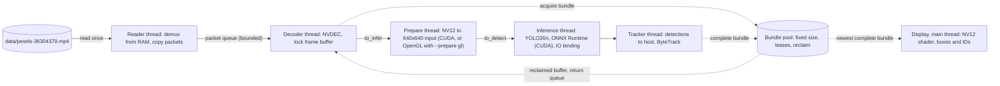

# Performance and design in detail

The [README](../README.md) gives the short version of v2: what it does, how to build and run it, the charts and the
architecture. This document holds the rest: the stages in detail, every option, the scaling tables behind the charts,
the single-process runs, the limits and the security notes. The design record is
[docs/design/bundle-pipeline.md](design/bundle-pipeline.md).

## What this version does

`run_pipeline.py` runs YOLO26n detection and Ultralytics ByteTrack tracking on one video stream on one NVIDIA GPU, as
a pipeline of stages on separate threads. Frames move through reader, decoder, prepare, inference, tracker and display
stages as bundles from a fixed, preallocated pool, so memory is bounded and a slow stage can hold back a faster one
only through the pool. The code is in `pipeline/`. `run_demo.py` and `video_reader.py` at the root are the v1 demo,
kept unchanged for comparison.

- **Reader** reads the MP4 once into RAM, demuxes it from memory with PyNvVideoCodec 2.2.3 and copies each packet into
  memory it owns before it queues it. At the end of the clip it starts a fresh demuxer for the next loop.
- **Decoder** is the only thread that touches the NVDEC decoder. It takes a free bundle when a frame emerges, and
  blocks when none is free, which fills the packet queue and blocks the reader. The library copies each decoded
  surface into a locked NV12 frame buffer; that buffer then travels in the bundle with no further copy before
  inference, and the decoder unlocks it when the bundle is reclaimed.
- **Prepare** converts the NV12 frame to the detector input (resized, padded, RGB, float32, 640x640) with PyTorch CUDA
  kernels. It has its own thread and queue, so it runs while inference works on the previous frame.
- **Inference** runs the model in ONNX Runtime with IO binding on GPU tensors; detections stay on the GPU. The model
  output is already final (`x1, y1, x2, y2, conf, class`), so there is no NMS step.
- **Tracker** copies the detections to host memory, runs ByteTrack and stores the tracks in source coordinates. The
  detection threshold defaults to 0.1, so ByteTrack's low-confidence stage receives data. The tracker resets when the
  clip loops.
- **Display** runs on the main thread, because GLFW needs its windows there. On a fixed tick it takes the newest
  complete bundle, uploads the NV12 frame to OpenGL and draws the boxes and track IDs over it. If no frame is newer
  than the last one shown, it waits up to `--display-grace-s` (default 0.2 s) for a complete frame, then shows the
  newest incomplete one with the latest tracks.

Two copies remain on the path: display copies each frame into an OpenGL pixel buffer, and the tracker moves detections
to host memory. A bundle is leased while any stage holds it and is never reclaimed while leased; an unleased bundle is
reclaimed when it has been shown or superseded, when it was abandoned, or when it is older than `--max-age-s`.



While it runs, the program prints one JSON line per second with the current rates (over the last second), the
average rates since start and the pool counts. The window shows the same current and average rates. At the end it
prints one JSON summary: frame counts per stage, `fps` (which includes pipeline start-up and shutdown),
`steady_fps` (from the first to the last event of each stage), median stage times in `median_ms`, and the pool
statistics.

The design, the measurements behind each decision and the risks are in
[docs/design/bundle-pipeline.md](design/bundle-pipeline.md).

## Running in detail

You need an NVIDIA GPU with a current driver. Run every command from the repository root. The scripts set the
Ultralytics settings folder to `.ultralytics` in the repository.

`requirements-pipeline.txt` installs the pins in `requirements-windows-plan.txt` (Ultralytics, ONNX Runtime GPU,
OpenCV, ONNX, NumPy, PyNvVideoCodec 2.2.3, and the CUDA 13.0 builds of torch and torchvision from the PyTorch index)
and adds GLFW, PyOpenGL, the CUDA Python bindings and pytest. PyNvVideoCodec 2.2.3 is the only tested version; keep
that pin.

The test clip is [Pexels video 36304379](https://www.pexels.com/video/busy-urban-intersection-from-above-36304379/),
"Busy urban intersection from above", subject to the Pexels license (see [NOTICE](../NOTICE)). It is not part of the
repository.

### Native Windows

From PowerShell:

```powershell
py -m venv .venv                                              # once
.\.venv\Scripts\Activate.ps1
python -m pip install -r requirements-pipeline.txt            # once
python download_clip.py                                       # once: data\pexels-36304379.mp4
python prepare_model.py                                       # once: yolo26n.onnx
```

Do not copy a Linux virtual environment to Windows. Then play the clip in a window for two loops, or run three loops
headless at maximum pace:

```powershell
python run_pipeline.py --loops 2
python run_pipeline.py --no-display --pace max --loops 3
```

### Linux

This version was measured on native Windows only; the Linux commands below are untested.

```bash
python3 -m venv .venv
source .venv/bin/activate
python -m pip install -r requirements-pipeline.txt
python download_clip.py
python prepare_model.py
python run_pipeline.py --no-display --pace max --loops 3
```

### Options

- `--loops N`: N passes over the clip (default 1); `--loops 0` repeats until stopped.
- `--pace realtime`, the default, releases frames at the source frame rate, so `--display-fps 25` (the default) shows
  the clip at normal speed. `--pace max` runs unpaced for benchmarks; the window then samples the stream and the clip
  plays fast.
- `--drop-policy none`, the default, processes every decoded frame. `--drop-policy oldest` lets the prepare stage skip
  frames more than `--max-lag-s` (default 0.5 s) behind their source time, for live sources; it is rejected with
  `--pace max`. Under this policy ByteTrack sees gaps, which shorten its track buffer in real time.
- `--no-display` runs headless; `--display-size WIDTHxHEIGHT` sets the window size (default 1920x1080).
- `--prepare cuda`, the default, prepares frames with PyTorch CUDA kernels and loads no GLFW or OpenGL for preparation;
  a `--no-display` run loads neither. `--prepare gl` runs the same conversion as an OpenGL fragment shader on a hidden
  window. It needs an OpenGL driver with a compatibility profile and a desktop session, was tested on an OpenGL 4.6
  driver, and supports only `--gpu-id 0`.
- `--input PATH` and `--model PATH` choose the clip and the ONNX model; `--conf` (default 0.1) is the detection
  threshold; `--tracker` (default `bytetrack.yaml`) names the Ultralytics tracker settings; `--gpu-id` chooses the GPU.
- `--pool-size` (default 16, at least 4), `--packet-queue` (default 64), `--max-age-s` (default 2.0) and
  `--display-grace-s` (default 0.2) tune the pool and the queues.

Press Q or Esc, or close the window, to stop. Closing the window is tested; the Q and Esc keys and Ctrl-C are not.

## Scaling: 1 to 8 processes

Measured on 2026-11-06 on native Windows 11 with an NVIDIA GeForce RTX 2070 SUPER (8 GB, driver 616.56), an Intel Core
i7-9700K (8 cores) and 32 GB of RAM, with `--prepare cuda`. Each process runs one stream of the test clip
(1920x1080, 25 FPS, 611 frames), headless (`--no-display`), for 2 loops; all processes start within about a second;
every point is one run, and the runs were made one at a time.

- **Total FPS** is the sum of the processes' `steady_fps.tracked`, from the first to the last tracked frame.
- **Latency estimate** is the sum of the medians of `source_lag` (from a frame's due time to the start of its
  preparation), preparation, inference and tracking, taken as the median over the processes. v2 does not record the
  time a frame waits in the queues after preparation, so the estimate is a lower bound. Without the cap the source
  clock does not apply, so there is no latency figure.
- **GPU busy** (SM utilisation) and **NVDEC** come from `nvidia-smi dmon`, **CPU** (all 8 logical CPUs) from
  `typeperf`, sampled once a second and averaged over the busy part of the run.
- **GPU memory** is the card's peak during the run, sampled once a second, minus the memory in use just before it
  started (3.55 to 3.84 GB, held by other programs on the desktop).
- Runs stop when free GPU memory falls below 400 MB or available host memory below 2 GB. Only the run of 8 processes
  without the cap was stopped, after 39 s with 386 MB free; host memory never fell below 3.8 GB.

| At 25 FPS per stream | 1 | 2 | 3 | 4 | 5 | 6 | 7 | 8 |
| --- | --- | --- | --- | --- | --- | --- | --- | --- |
| Total FPS | 25.6 | 50.7 | 76.1 | 101.8 | 127.2 | 150.0 | 150.3 | 153.1 |
| Slowest process, FPS | 25.6 | 25.3 | 25.4 | 25.4 | 25.4 | 24.9 | 21.4 | 18.6 |
| Latency estimate, ms | 17.9 | 24.2 | 28.4 | 28.7 | 29.9 | 356 | 5202 | 10685 |
| GPU busy, % | 23 | 34 | 47 | 58 | 75 | 93 | 91 | 92 |
| NVDEC, % | 4 | 3 | 5 | 6 | 7 | 9 | 8 | 8 |
| CPU, % | 16 | 26 | 31 | 62 | 59 | 99 | 99 | 99 |
| GPU memory, MB | 484 | 982 | 1473 | 2388 | 2691 | 2900 | 3270 | 3935 |
| Median inference, ms | 7.3 | 13.5 | 17.6 | 18.0 | 18.7 | 39.6 | 45.5 | 52.9 |

| Without the cap (`--pace max`) | 1 | 2 | 3 | 4 | 5 | 6 | 7 | 8 |
| --- | --- | --- | --- | --- | --- | --- | --- | --- |
| Total FPS | 129.4 | 158.5 | 155.4 | 152.4 | 147.1 | 150.0 | 151.8 | stopped |
| Slowest process, FPS | 129.4 | 78.8 | 51.5 | 38.0 | 29.2 | 24.9 | 21.3 | stopped |
| GPU busy, % | 37 | 78 | 87 | 88 | 91 | 92 | 91 | stopped |
| NVDEC, % | 5 | 8 | 8 | 8 | 8 | 8 | 8 | stopped |
| CPU, % | 43 | 50 | 68 | 82 | 97 | 98 | 99 | stopped |
| GPU memory, MB | 511 | 997 | 1496 | 1995 | 2925 | 3217 | 3467 | stopped |
| Median inference, ms | 7.2 | 12.3 | 19.1 | 25.7 | 32.8 | 39.1 | 45.6 | stopped |

At 25 FPS per stream 1 to 5 processes hold 25 FPS with a latency estimate under 30 ms. At 6 the slowest process falls
just below 25 FPS (24.9) and frames fall behind the source: the median source lag is 0.3 s over the processes and 0.85 s in
the worst one. From 7 processes the total stays at about 150 FPS, so each stream gets less (21.4 at 7, 18.6 at 8)
and the backlog grows to seconds.

Without the cap one process reaches 129.4 FPS with the GPU only 37% busy: one process runs one frame at a time through
its stages, so its own serial path limits it. From 2 processes the total is about 150 to 158 FPS whatever the count,
with the GPU 78 to 92% and the CPU up to 99% busy, and median inference per frame grows with the number of processes
that share the GPU (7.2 ms with one, 45.6 ms with seven). Each process adds about 0.5 GB of GPU memory, its own model,
session and buffers. That cost, and the ceiling of about 150 FPS, are what the next version's shared inference server
removes.

The run with one process without the cap lasted about 10 s, so its GPU and CPU means include start-up; the 3-loop runs
below reach 146.5 FPS.

## Single-process runs and windows

The scaling tables above replace the morning's runs of several headless processes. The runs below were made earlier on
2026-11-06, on one machine: native Windows 11, an NVIDIA GeForce RTX 2070 SUPER
(8 GB, driver 616.56), an Intel Core i7-9700K (8 cores) and 32 GB of RAM, with PyNvVideoCodec 2.2.3, ONNX Runtime
1.31.1 and `--prepare cuda` unless stated otherwise, on the clip above (1920x1080, 25 FPS, 611 frames). Runs were
made one at a time, and each row is one run unless two values are shown. GPU % (SM utilization) and NVDEC % come from
`nvidia-smi dmon`, CPU % (all cores) from `typeperf`, both sampled once a second and averaged over the busy part of
the run. Peak GPU memory was sampled with `nvidia-smi` once a second and includes about 3.5 GB that other applications
on the desktop already used. `steady_fps.tracked` runs from the first to the last tracked frame; `fps.tracked`
includes pipeline start-up and shutdown. Other hardware is untested.

### Without a window (headless)

**One process at max pace**, `--no-display --pace max`, 3 loops (1833 frames), two runs:

| Run | `steady_fps.tracked` | `fps.tracked` | Median prepare | Median inference | Median tracking | GPU % | NVDEC % | CPU % |
| --- | --- | --- | --- | --- | --- | --- | --- | --- |
| 1 | 146.5 | 139.9 | 1.26 ms | 6.31 ms | 1.25 ms | 54.4 | 8.3 | 31.6 |
| 2 | 146.5 | 139.7 | 1.20 ms | 6.33 ms | 1.23 ms | 51.1 | 7.8 | 30.9 |

The two runs differ by less than 0.1 percent.

**CUDA and OpenGL preparation**, same settings, two alternating runs per mode (`cuda`, `gl`, `cuda`, `gl`):

| `--prepare` | `steady_fps.tracked` | Median prepare | Median inference | Median tracking | GPU % |
| --- | --- | --- | --- | --- | --- |
| `cuda` | 146.3 and 146.2 | 1.20 and 1.19 ms | 6.38 and 6.32 ms | 1.25 and 1.24 ms | 54.4 and 54.6 |
| `gl` | 144.1 and 148.8 | 3.09 and 3.13 ms | 6.24 and 6.22 ms | 1.19 and 1.19 ms | 58.1 and 62.6 |

The runs overlap, so there is no clear throughput winner, but `gl` takes about 2.6 times as long to prepare a frame
and uses more of the GPU. The shader resizes, converts and pads in one pass and adds two GPU copies per frame:
decoder memory into an OpenGL upload buffer, and the readback buffer into the input tensor. Its output matches the
CUDA path closely; the comparison is in the design document.

### With windows

**One process at 25 FPS**, 2 loops, display on at `--display-fps 25`: every frame was processed (1222 tracked), 1208
were shown (1203 with complete tracks, 5 with incomplete tracks), 14 were not shown (the pool counted 14 superseded),
4 ticks were empty and 8 ran late. GPU 32.8 %, NVDEC 4.4 %, CPU 15.7 %. Median inference was 12.0 ms, prepare 1.0 ms,
display 1.49 ms and tracking 1.20 ms.

**Several processes at 25 FPS**, one stream and one window per process, 2 loops (1222 frames per process), all
processes started within about a second:

| Processes | Slowest process `fps.tracked` (`steady_fps.tracked`) | Total `fps.tracked` | GPU % | NVDEC % | CPU % | Peak GPU memory | Frames not shown per process |
| --- | --- | --- | --- | --- | --- | --- | --- |
| 2 | 24.95 (25.34) | 49.9 | 34.4 | 4.1 | 26.3 | 4720 MiB | 21 and 30 |
| 4 | 24.94 (25.43) | 99.8 | 63.2 | 5.7 | 45.5 | 5648 MiB | 31 to 45 |

Every process tracked all 1222 frames; the frames not shown were superseded in the pool before the display reached
them. 6 or more processes with windows were not tested.

The display waits for a frame that is still in flight (up to `--display-grace-s`, and up to half a tick before it
counts an empty tick), and preparation has its own thread. The measurements that led to both are in
[docs/design/bundle-pipeline.md](design/bundle-pipeline.md).

## Limits and the next version

- One process still runs one frame at a time through inference, at batch size 1, and handles one stream. Several
  streams mean several processes, each with its own model and session, competing for one GPU: on the measured machine
  that holds 25 FPS on 5 streams headless, falls just behind at 6, and tops out at about 150 FPS in total (see
  [Scaling](#scaling-1-to-8-processes)).
- At a display paced to 25 FPS a few frames are still not shown: 14 of 1222 with one window, and 21 to 45 of 1222 per
  process with 2 or 4 windows.
- `--prepare gl` needs a desktop session and runs only on GPU 0, and it is not faster than `--prepare cuda`.
- The Q and Esc keys, Ctrl-C and the visual accuracy of boxes and track IDs were not validated; closing the window was.
  Dragging a window on Windows can block the event loop; reclaim inside the pool and `--max-age-s` keep the pipeline
  moving.
- `GetLockedFrame`, `UnlockFrame` and packet construction in PyNvVideoCodec are lightly documented, and only version
  2.2.3 was tested.
- There is no recording and no RTSP input. Everything was measured on one clip.
- `download_clip.py` does not check the downloaded file. A failed download may leave a partial file, which a later run
  treats as complete; delete `data/pexels-36304379.mp4` and run it again.

The next version, on the
[main branch](https://github.com/BarabashkaD/multistream-gpu-inference/tree/main), runs one inference server and one
process per stream. The server holds the model once and batches frames from all streams; each stream's process
decodes, tracks and shows its stream, and frames cross processes as GPU pointers through CUDA IPC. Its README has the
design and the measurements.

## Security notes

- `run_pipeline.py` reads the input clip (the whole file into RAM), the ONNX model and the Ultralytics tracker
  settings. It writes no file of its own: the per-second status lines and the final JSON summary go to the console.
  Ultralytics keeps its settings in `.ultralytics` in the repository.
- `run_demo.py`, the v1 demo, writes an MP4 only with `--output`.
- The code in this repository opens no network port and does not listen for connections. Its only network use is the
  two downloads: `download_clip.py` downloads the clip from `videos.pexels.com` over HTTPS to
  `data/pexels-36304379.mp4`, and `prepare_model.py` has Ultralytics download the `yolo26n.pt` weights over HTTPS when
  they are missing, then exports `yolo26n.onnx` next to them on the CPU. pip downloads the packages during setup.
- The clip, the weights and the model, `.venv` and `.ultralytics` are listed in `.gitignore` and are not committed.
