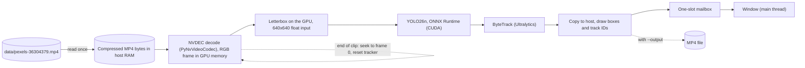

# Performance and design in detail

The [README](../README.md) gives the short version of v1: what it does, how to build and run it, the charts and the
architecture. This document holds the rest: the program in detail, the source and model, every command and option,
the scaling tables behind the charts, the runs with windows, the limits and the security notes.

## What this version does

`run_demo.py` runs YOLO26n detection and Ultralytics ByteTrack tracking on one video stream on one NVIDIA GPU. It
reads the compressed MP4 once into host RAM and gives that byte buffer to the seekable decoder of NVIDIA
PyNvVideoCodec 2.2.3 in NVDEC mode. It does not predecode all frames and it does not reopen the file at each loop. The
decoder may copy the encoded buffer into its own native storage, as reported by PyNvVideoCodec.

Each decoded frame stays in GPU memory as an RGB tensor. It is letterboxed on the GPU to the model input (640x640 by
default, padded with grey 114/255) and passed to the YOLO26n model, exported to ONNX and run in ONNX Runtime with the
CUDA execution provider. ByteTrack uses only the boxes, not the image, so a frame is copied to host memory only when it
must be drawn, in a window or into a recording. With a window, inference runs on a worker thread and the window on the
main thread, which takes frames from a one-slot mailbox, so a slow display drops display frames and never slows
inference down. At the end the program prints one JSON summary: frames and FPS per loop and in total, the decoder, the
ONNX Runtime providers and, with a window, the display counters.

At each loop boundary the decoder seeks to frame zero and the ByteTrack state and statistics reset, while the model
and its ONNX Runtime session stay loaded. `launch_instances.py` runs several such streams as independent OS
processes.



`--decoder opencv` replaces NVDEC with a CPU OpenCV decoder, kept as an explicit fallback. `--backend cuda` makes a
missing CUDA execution provider an error; `--backend auto`, the default, falls back to the CPU and prints why, but the
NVDEC path refuses to run without CUDA.

## Source and model

- Video: [Pexels 36304379](https://www.pexels.com/video/busy-urban-intersection-from-above-36304379/), "Busy urban
  intersection from above", subject to the Pexels license (see [NOTICE](../NOTICE)). It is not part of the repository.
- Size: 10,603,143 bytes (10.11 MiB); verified metadata: 1920x1080, 25 FPS, 611 frames.
- Model: YOLO26n exported to ONNX by `prepare_model.py`.
- Tracking: Ultralytics ByteTrack.
- Decoder: NVIDIA PyNvVideoCodec 2.2.3 in NVDEC mode.
- Inference: ONNX Runtime with CUDAExecutionProvider, with a CPUExecutionProvider fallback only when the selected
  backend allows it.

## Running in detail

You need an NVIDIA GPU with a current driver. Run every command from the repository root. The scripts set the
Ultralytics settings folder to `.ultralytics` in the repository.

### Native Windows

From PowerShell:

```powershell
.\setup_windows.ps1                       # creates .venv and installs requirements-windows-plan.txt
.\.venv\Scripts\Activate.ps1
python download_clip.py                   # data\pexels-36304379.mp4
python prepare_model.py                   # yolo26n.onnx
```

`setup_windows.ps1` creates the virtual environment `.venv` with the `py` launcher, then upgrades pip and installs the
pins in `requirements-windows-plan.txt`, which take the CUDA 13.0 build of torch from the PyTorch index.
`.\setup_windows.ps1 -SkipInstall` only creates the environment. Do not copy a Linux virtual environment to Windows.

Run one headless instance, then three windowed instances:

```powershell
.\run_windows.ps1 --instances 1 --headless --loops 1 --decoder nvdec --backend cuda
.\run_windows.ps1 --instances 3 --loops 5 --decoder nvdec --backend cuda
```

`run_windows.ps1` runs `launch_instances.py` with the Python in `.venv` and stops if it is missing.
`launch_instances.ps1` does the same but falls back to the first `python` on `PATH`. Use `--backend cuda` so a missing
GPU provider fails instead of falling back. ONNX Runtime may log `No registered plugin EP device found for
'CUDAExecutionProvider'` at startup; in the measured runs below the session still ran on the GPU.

### Linux

The Linux commands were tested under WSL2.

```bash
python3 -m venv .venv
source .venv/bin/activate
python -m pip install -r requirements.txt
python download_clip.py
python prepare_model.py
```

`requirements.txt` pins the direct dependencies; `requirements.lock.txt` pins the full set, indirect dependencies
included.

Windowed playback without recording:

```bash
python run_demo.py --decoder nvdec --input data/pexels-36304379.mp4 --model yolo26n.onnx
```

Press Q or Esc, close the window, or press Ctrl-C to stop. Without `--output` there is no video writer and no output
file.

Headless single pass, and a full headless two-loop run:

```bash
python run_demo.py --decoder nvdec --no-display --loops 1 --input data/pexels-36304379.mp4 --model yolo26n.onnx
python run_demo.py --decoder nvdec --no-display --loops 2 --input data/pexels-36304379.mp4 --model yolo26n.onnx
```

Bounded infinite-loop test:

```bash
timeout --foreground --signal=INT --kill-after=10s 35s \
  python run_demo.py --decoder nvdec --loops 0 --input data/pexels-36304379.mp4 --model yolo26n.onnx
```

The tested run crossed the end of the clip twice, began a third loop and stopped through the normal interrupt path.
No output video was created.

Two headless instances, two frames each:

```bash
python launch_instances.py --instances 2 --headless --loops 1 --max-frames 2 \
  --decoder nvdec --input data/pexels-36304379.mp4 --model yolo26n.onnx
```

### Loops and recording

- Omitted `--loops` or `--loops 1`: one pass.
- `--loops N`, where N is positive: exactly N passes.
- `--loops 0`: repeat until Q or Esc, closing the window, or Ctrl-C.
- The loop history and the timing samples are bounded, so `--loops 0` does not accumulate unbounded history.
- `--output PATH` records the annotated frames to MP4. It is rejected with `--loops 0`; use a finite loop count for
  recording. With more than one loop, the file names get `-loop-001`, `-loop-002` and so on.
- Display frames may be dropped by the one-slot mailbox; processed and recorded frames are never dropped for display
  reasons.

`launch_instances.py` uses the Python that runs it, starts independent OS processes, creates a unique run folder with
one log per instance, and stops only the children it started. Recording is opt-in with `--output-dir <directory>`;
without it, no MP4 is written.

## Scaling: 1 to 8 processes

Measured on 2026-11-06 on native Windows 11 with an NVIDIA GeForce RTX 2070 SUPER (8 GB, driver 616.56), an Intel Core
i7-9700K (8 cores) and 32 GB of RAM, with `launch_instances.py --instances N --headless --loops 3 --decoder nvdec
--backend cuda`. Each process runs one stream of the test clip (1920x1080, 25 FPS, 611 frames); v1 has no pacing, so
every process runs as fast as it can. All processes start within 0.1 s of each other and ran together for at least 92%
of their measured loops. Every point is one run, and the runs were made one at a time.

- **FPS per process** is the mean processing rate of loops 2 and 3; loop 1 includes loading the model. **Total FPS**
  is the sum over the processes.
- **Time per frame** is 1000 divided by the FPS of the slowest process. v1 records no latency from a frame's due time.
- **GPU busy** (SM utilisation) and **NVDEC** come from `nvidia-smi dmon`, **CPU** (all 8 logical CPUs) from
  `typeperf`, sampled once a second and averaged over the busy part of the run.
- **GPU memory** is the card's peak during the run, sampled once a second, minus the memory in use just before it
  started (3284 MB, held by other programs on the desktop).
- Runs stop when free GPU memory falls below 400 MB or available host memory below 2 GB; no run was stopped.

| Processes | 1 | 2 | 3 | 4 | 5 | 6 | 7 | 8 |
| --- | --- | --- | --- | --- | --- | --- | --- | --- |
| Total FPS | 111.7 | 135.2 | 132.7 | 133.5 | 132.2 | 131.6 | 132.5 | 126.3 |
| Slowest process, FPS | 111.7 | 67.4 | 44.0 | 33.2 | 26.3 | 21.9 | 18.8 | 15.4 |
| Time per frame of the slowest process, ms | 9.0 | 14.8 | 22.7 | 30.1 | 38.0 | 45.8 | 53.2 | 65.1 |
| GPU busy, % | 40 | 83 | 91 | 94 | 94 | 95 | 95 | 94 |
| NVDEC, % | 6 | 7 | 8 | 8 | 8 | 8 | 8 | 7 |
| CPU, % | 42 | 57 | 67 | 80 | 90 | 100 | 100 | 100 |
| GPU memory, MB | 380 | 756 | 1132 | 1508 | 1884 | 2260 | 2636 | 2964 |

One process reaches 111.7 FPS with the GPU 40% busy; it runs decoding, preparation, inference, tracking and drawing
one after another, so its own serial path limits it. From 2 processes the total stays at about 132 to 135 FPS, with the
GPU 83 to 95% busy, and dips to 126 FPS at 8, when the CPU has been at 100% since 6. Up to 5 processes the slowest one
still runs faster than the clip's 25 FPS. Each process adds about 380 MB of GPU memory and about 1.3 GB of host memory:
its own decoder, model, session and tracker. The one-process run is about 22 s long, so its GPU and CPU means include
loading the model.

## Runs with windows

The scaling tables above replace the morning's headless run. The runs with windows below were made earlier on
2026-11-06.

Measured on 2026-11-06 on native Windows 11 with an NVIDIA GeForce RTX 2070 SUPER (8 GB, driver 616.56), an Intel
Core i7-9700K (8 cores), 32 GB RAM and Python 3.14.6, using the pins in `requirements-windows-plan.txt`, on the clip
above (1920x1080, 25 FPS, 611 frames), with `launch_instances.py --decoder nvdec --backend cuda`. Each row is one
separate run: 3 loops for one process, 4 loops for two and 5 loops for three.
`nvidia-smi dmon` and `typeperf` sampled once a second. FPS per process is the processing rate of the loops after the
first; the first loop is excluded because it includes model loading. Combined FPS is the sum over the processes. GPU
compute and NVDEC are means over the seconds in which GPU compute was at least 10%. CPU is system-wide, the mean over
the whole run. Other Python, driver or GPU combinations are untested.

### With windows

| Processes | FPS per process | Combined FPS | GPU compute | NVDEC | CPU |
| --- | --- | --- | --- | --- | --- |
| 1 | 84.5-85.3 | about 85 | about 47% | about 5% | about 41% |
| 2 | 51.7-56.3 | about 108 | about 87% | about 6% | about 55% |
| 3 | 32.3-44.8 | 106-114, about 110 | 93% mean, 96-98% steady | about 6% | about 65% |

With three processes, one process ran at 41.0-44.8 FPS and the other two at 32.3-35.2 FPS. That process finished
first, so the fifth loop of the other two ran with less contention; the three-process figures use loops 2 to 4, during
which all three ran together for about 75 s. The 93% GPU mean includes the seconds of start-up and shutdown; while all
three ran, GPU compute stayed at 96-98%.

At three windowed processes GPU compute is the limit: it stays at 96-98% while NVDEC stays near 6%. The combined
throughput is about 110 FPS, about 1.3 times one windowed process and about the same as two, so more processes add
little.

## Limits and the next version

- Each process owns its own compressed RAM buffer, decoder, model and ONNX Runtime session, and ByteTrack state, so GPU
  memory is duplicated for every stream. Keep the instance count conservative on a shared GPU.
- A process handles one frame at a time: decoding, preparation, inference, tracking and drawing run one after another.
- At three windowed processes on the card above, GPU compute is the limit (96-98%, NVDEC near 6%), and the combined
  throughput, about 110 FPS, is only about 1.3 times that of one windowed process.
- Not yet validated on Windows: recording, Q, Esc and Ctrl-C shutdown, and the visual accuracy of boxes and track IDs.
  Closing a window was exercised and exited cleanly.
- `download_clip.py` does not check the downloaded file. A failed download may leave a partial file, which a later run
  treats as complete; delete `data/pexels-36304379.mp4` and run it again.

The next version,
[v2-bundle-pipeline](https://github.com/BarabashkaD/multistream-gpu-inference/tree/v2-bundle-pipeline), keeps one
stream per process but splits its work into stages on separate threads that pass frames in bundles from a fixed pool,
so that preparing a frame overlaps inference on the previous one. Its README has the design and the measurements.

## Security notes

- `run_demo.py` reads the input clip, the whole file into RAM for NVDEC, and the ONNX model. It writes an MP4 only with
  `--output`, and prints its logs and the JSON summary to the console. Ultralytics keeps its settings in `.ultralytics`
  in the repository.
- `launch_instances.py` creates `runs/launcher-<UTC time>-<process id>/logs/` (or the folder given with `--run-dir`)
  with one log per instance, and with `--output-dir` one folder per instance holding `result.mp4`. It refuses to
  reuse an existing folder.
- `setup_windows.ps1` writes only to `.venv` and downloads the packages with pip.
- The code in this repository opens no network port and does not listen for connections. Its only network use is the
  two downloads: `download_clip.py` downloads the clip from `videos.pexels.com` over HTTPS to
  `data/pexels-36304379.mp4`, and `prepare_model.py` has Ultralytics download the `yolo26n.pt` weights over HTTPS when
  they are missing, then exports `yolo26n.onnx` next to them on the CPU.
- The clip, the weights, `.venv`, `.ultralytics` and `runs/` are listed in `.gitignore` and are not committed.
